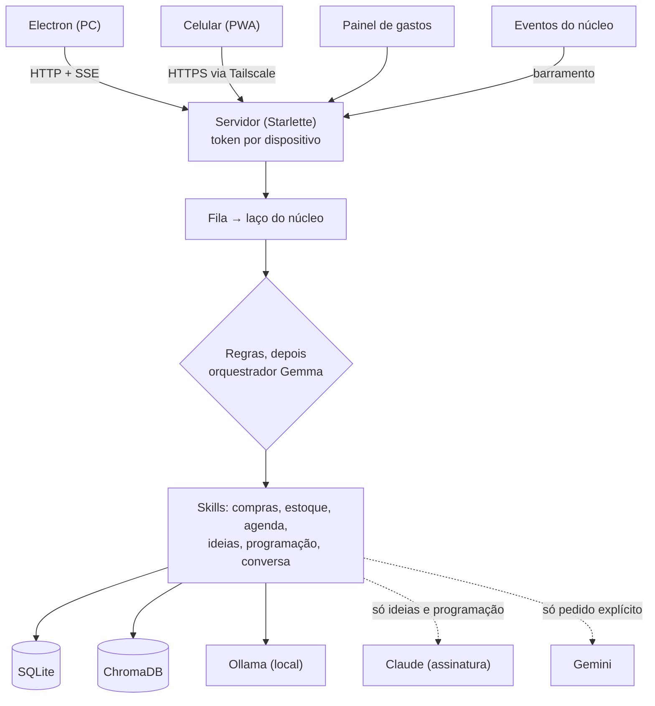

# Assistente Doméstico Inteligente (V4 → V5.5)

[](https://github.com/Felipe-Stu/assistente-domestico/actions/workflows/testes.yml)

Assistente doméstico que registra compras (por texto, voz, nota fiscal ou foto) e responde perguntas por linguagem natural usando **LLMs executados localmente**. O núcleo roda como serviço no PC de casa e atende a janela do PC, uma página instalável no celular e um painel de gastos. A nuvem (Gemini) é usada apenas como contingência para perguntas gerais, e os dados da casa não saem da máquina.

Projeto pessoal, desenvolvido em versões incrementais (V1 → V4) com apoio de ferramentas de IA (AntiGravity IDE e Claude).

▶️ **[Demonstração em vídeo (1 min)](https://youtu.be/29LEQyIg764)**: registro de compra, pergunta ao LLM local, análise do próprio projeto pelo ProjectAnalyzer e "desfazer" resolvido por regra, tudo rodando localmente.

**Python · Starlette/uvicorn (HTTP + SSE) · Electron · PWA · Ollama (Gemma 4, Qwen2.5-VL, Qwen2.5-Coder) · ChromaDB · SQLite · MCP**

---

## Destaques

| | |
|---|---|
| **IA local primeiro** | Gemma 4 (e4b) orquestra e extrai dados; Qwen2.5-Coder 7B atende programação e análise de projetos. A troca de modelos libera a VRAM entre eles |
| **Roteamento por regras antes da IA** | 9 de 10 comandos medidos foram resolvidos sem inferência, em menos de 0,1 s; o LLM só classifica os casos ambíguos |
| **Privacidade por política** | Compras, estoque e agenda nunca saem da máquina; só perguntas gerais podem ir ao Gemini e só programação pode ir ao Claude. As duas chaves são opcionais |
| **Compras confiáveis** | Extração estruturada em JSON, validação de total × quantidade × preço, confirmação em caso de dúvida e "desfazer última compra" |
| **Memória semântica (RAG)** | ChromaDB com embeddings multilíngues na CPU; só fatos relevantes são memorizados e reinjetados no contexto |
| **ProjectAnalyzer** | Analisa repositórios (AST, grafo de dependências, inconsistências) e gera documentação técnica 100% local, ocultando segredos |
| **Núcleo como serviço** | API HTTP com eventos do servidor (SSE), token por dispositivo (só o hash gravado, revogável), sem porta aberta para a internet: o celular entra pelo Tailscale |
| **Notas fiscais de verdade** | Leitor exato da NFC-e e da NF-e (HTML ou texto), foto lida em duas etapas (transcrição pelo modelo de imagem, estrutura pelo modelo de texto), conferência antes de gravar, chave de acesso com dígito verificador contra nota repetida |
| **Consultas e correções** | "Quanto gastei com limpeza em novembro?", comparação de períodos, preço de produto; correções e observações pelo chat, com antes e depois e confirmação |
| **Qualidade** | **353 testes automatizados** executados a cada push, avaliação dos prompts com histórico de medições, cópia de segurança diária, registro de eventos em JSON com tempo por etapa e documentação de cada versão, incluindo o que ainda não funciona |

## Arquitetura



- **Núcleo como serviço (V5.5):** `app/servidor.py` só enfileira; o laço do núcleo executa um pedido por vez e publica eventos num barramento, que chega a todos os clientes por SSE. Detalhes em [`Sobre a Versão/09`](Sobre%20a%20Vers%C3%A3o/09%20-%20Servidor%2C%20Celular%20e%20Painel%20(V5.5).md).
- **Skills:** cada capacidade é uma pasta em `skills/` com instruções, prompts e gatilhos; o roteador tenta regras antes do modelo.
- **Persistência híbrida:** SQLite para dados exatos (valores em centavos) e ChromaDB para busca semântica e memória, com cópia de segurança diária.
- **Observabilidade:** cada solicitação recebe um identificador; roteamento, extração, banco e voz são medidos e gravados como JSON.

## Estado atual

| Funciona | Parcial | Planejado |
|---|---|---|
| Compras por texto, voz, nota fiscal (HTML, PDF, texto colado) e foto, com conferência | Leitura de foto depende do modelo de imagem (qwen2.5vl:7b medido: 5 de 5 campos numa nota) | Leitura do QR Code do cupom (V5) |
| Consultas de gastos, correções e observações | Modo voz (depende de microfone e serviços externos) | App Android (V6) |
| Servidor, página do celular, painel de gastos, modo demonstração | Servidor MCP pronto, desligado por padrão | Voz local e palavra de ativação (V6.5) |
| Estoque alimentado pelas compras; agenda; ideias analisadas pelo Claude | Bot do Telegram só guarda ideias e recebe notas | Casa conectada (V7) |

O retrato completo, com evidências e problemas abertos, está em [`Sobre a Versão/08 - Estado Atual da V4.md`](Sobre%20a%20Vers%C3%A3o/08%20-%20Estado%20Atual%20da%20V4.md).

## Como executar

Requisitos: Python 3.10+, Node.js e [Ollama](https://ollama.com). Feito e testado no Windows; o código não depende dele (os bipes do modo voz só tocam no Windows).

```bash
ollama pull gemma4:e4b
ollama pull qwen2.5-coder:7b
pip install -r requirements.txt      # ou requirements-lock.txt, com as versões exatas testadas
npm install
```

Copie `.env.example` para `.env`. A chave do Gemini é opcional: sem ela, todo o processamento fica local.

```bash
ollama serve
npm start
```

No Windows, `iniciar-assistente.bat` faz os dois. O Electron inicia o servidor (`app/servidor.py`, porta 8765) e se conecta a ele; `iniciar-servidor.bat` deixa o assistente no ar sem a janela, para o celular e o painel. Celular: veja o passo a passo do Tailscale em `Sobre a Versão/09`. Demonstração com dados fictícios: `iniciar-demo.bat`. O Electron usa `ASSISTENTE_PYTHON`, se definido; senão o `.venv` do projeto; senão `python` (Windows) ou `python3`. Modelos, tempos e endereço do Ollama ficam no `.env` (veja `.env.example`).

Somente o back-end: `python app/servidor.py` (API) ou `python app/main.py` (ponte antiga por stdin).

Testes: `python -m unittest discover -s tests -v` (em uma máquina sem as dependências completas, `pip install -r requirements-ci.txt` basta para a suíte)

## Estrutura

```text
main.js, preload.js, renderer.js   Electron: janela, ponte segura e interface do chat
app/main.py                        AssistenteRuntime: serviços e pipeline de cada pedido
app/laco.py, app/documentos_app.py Partida e laço de comandos; importação de notas fiscais
app/servidor.py, app/eventos.py    API (HTTP + SSE, tokens por dispositivo) e barramento de eventos
app/mcp_casa.py                    Servidor MCP somente leitura (opcional)
cliente-api.js                     Electron como cliente da API
web/                               Página instalável do celular (PWA) e painel de gastos
services/                          Assistentes, provedores de LLM, voz, áudio, banco e logs
services/vector/                   Embeddings, ChromaDB, memória, busca semântica e RAG
services/project_analyzer/         Skill de análise de projetos e documentação
scripts/                           Banco vetorial, cópia de segurança, leitura dos logs e medições
skills/                            Uma pasta por capacidade: instruções, prompts e gatilhos (formato em skills/README.md)
evals/                             Conjunto de avaliação usado por scripts/avaliar.py
tests/                             353 testes automatizados (LLM, ChromaDB e embeddings simulados; o servidor sobe de verdade quando as dependências estão instaladas)
Sobre a Versão/                    Documentação técnica e evolução V1 → V4
```

## Documentação

- [Resumo do sistema](Sobre%20a%20Vers%C3%A3o/01%20-%20Resumo%20do%20Sistema.md)
- [Arquitetura geral](Sobre%20a%20Vers%C3%A3o/03%20-%20Arquitetura%20Geral.md)
- [Skill ProjectAnalyzer](Sobre%20a%20Vers%C3%A3o/07%20-%20Skill%20ProjectAnalyzer.md)
- [Evolução da V3 para a V4](Sobre%20a%20Vers%C3%A3o/06%20-%20Evolu%C3%A7%C3%A3o%20da%20V3%20para%20a%20V4.md)
- [Evolução da V4 para a V4.1](Sobre%20a%20Vers%C3%A3o/06%20-%20Evolu%C3%A7%C3%A3o%20da%20V4%20para%20a%20V4.1.md)
- [Estado atual](Sobre%20a%20Vers%C3%A3o/08%20-%20Estado%20Atual%20da%20V4.md)
- [Servidor, celular e painel (V5.5)](Sobre%20a%20Vers%C3%A3o/09%20-%20Servidor%2C%20Celular%20e%20Painel%20(V5.5).md)
- [CHANGELOG](CHANGELOG.md)

## Licença

[MIT](LICENSE)
