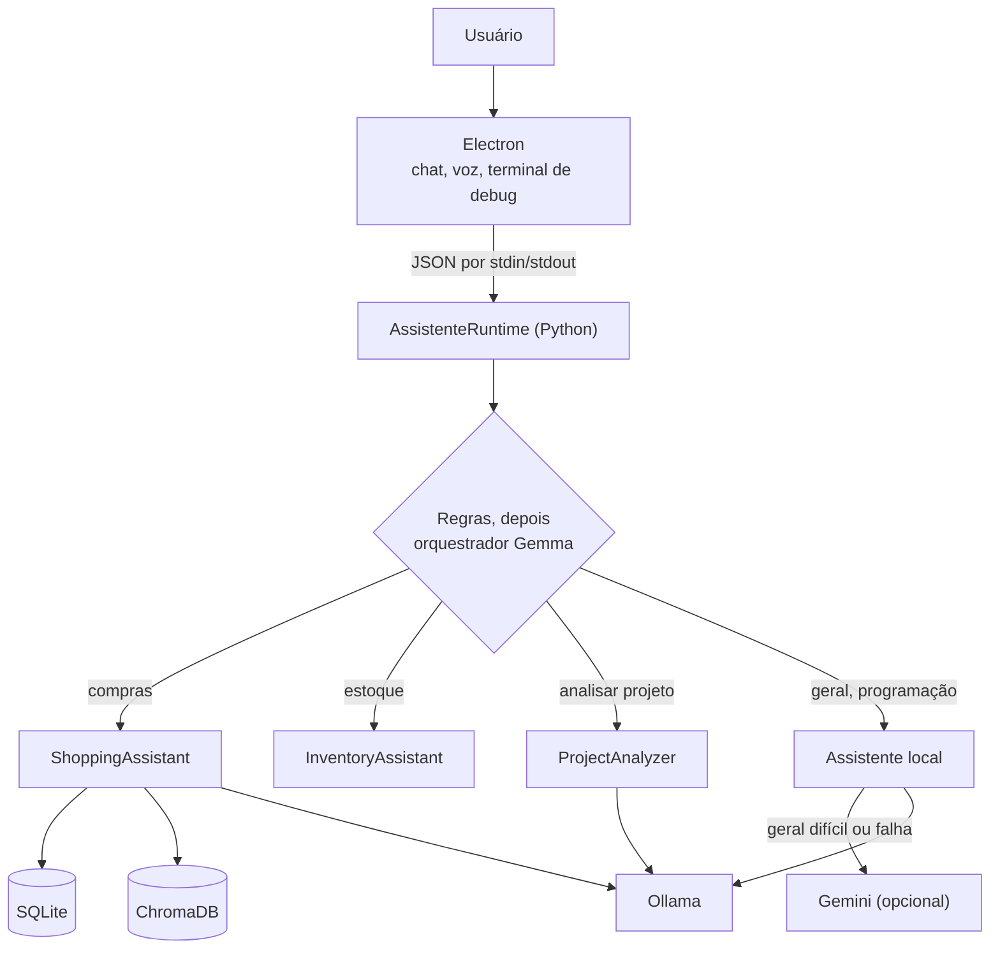

# Assistente Doméstico Inteligente (V4)

Assistente desktop que registra compras e responde perguntas por linguagem natural, em texto ou voz, usando **LLMs executados localmente**. A nuvem (Gemini) é usada apenas como contingência para perguntas gerais, e os dados da casa não saem da máquina.

Projeto pessoal, desenvolvido em versões incrementais (V1 → V4) com apoio de ferramentas de IA (AntiGravity IDE e Claude).

**Python · Electron · Ollama (Gemma 4, Qwen2.5-Coder) · ChromaDB · SQLite · sentence-transformers**

---

## Destaques

| | |
|---|---|
| **IA local primeiro** | Gemma 4 (e4b) orquestra e extrai dados; Qwen2.5-Coder 7B atende programação e análise de projetos. A troca de modelos libera a VRAM entre eles |
| **Roteamento por regras antes da IA** | 9 de 10 comandos medidos foram resolvidos sem inferência, em menos de 0,1 s; o LLM só classifica os casos ambíguos |
| **Privacidade por política** | Compras, estoque, agenda e programação nunca vão à nuvem; só perguntas gerais podem ir ao Gemini, e a chave é opcional |
| **Compras confiáveis** | Extração estruturada em JSON, validação de total × quantidade × preço, confirmação em caso de dúvida e "desfazer última compra" |
| **Memória semântica (RAG)** | ChromaDB com embeddings multilíngues na CPU; só fatos relevantes são memorizados e reinjetados no contexto |
| **ProjectAnalyzer** | Analisa repositórios (AST, grafo de dependências, inconsistências) e gera documentação técnica 100% local, ocultando segredos |
| **Qualidade** | ~8.000 linhas, **70 testes automatizados** aprovados e documentação de cada versão, incluindo o que ainda não funciona |

## Arquitetura



- **Electron** cuida da interface e inicia o back-end Python como processo filho, conversando por mensagens JSON.
- **Inicialização Text-First:** o chat fica disponível sem microfone; a voz (Google Speech + Edge TTS) é ativada sob demanda.
- **Persistência híbrida:** SQLite para dados exatos e ChromaDB para busca semântica e memória.

## Estado atual

| Funciona | Parcial | Planejado |
|---|---|---|
| Registro de compras por texto, com confirmação e desfazer | Consulta de estoque (a tabela de consumo ainda não é alimentada pelas compras) | Gestão preditiva de estoque de ponta a ponta |
| Roteamento por regras e política de nuvem | Modo Qwen como assistente de programação (sem execução de ferramentas) | Consultas de gastos e preços |
| Memória semântica e RAG | Modo voz (depende de microfone e serviços externos) | Agenda |
| ProjectAnalyzer | | |

O retrato completo, com evidências e problemas abertos, está em [`Sobre a Versão/08 - Estado Atual da V4.md`](Sobre%20a%20Vers%C3%A3o/08%20-%20Estado%20Atual%20da%20V4.md).

## Como executar (Windows)

Requisitos: Python 3.10+, Node.js e [Ollama](https://ollama.com).

```bash
ollama pull gemma4:e4b
ollama pull qwen2.5-coder:7b
pip install -r requirements.txt
npm install
```

Copie `.env.example` para `.env`. A chave do Gemini é opcional: sem ela, todo o processamento fica local.

```bash
ollama serve
npm start
```

Somente o back-end, sem interface: `python app/main.py`

Testes: `python -m unittest discover -s tests -v`

## Estrutura

```text
main.js, preload.js, renderer.js   Electron: janela, ponte segura e interface do chat
app/main.py                        AssistenteRuntime: inicialização, filas e roteamento
services/                          Assistentes, provedores de LLM, voz, áudio, banco e logs
services/vector/                   Embeddings, ChromaDB, memória, busca semântica e RAG
services/project_analyzer/         Skill de análise de projetos e documentação
scripts/                           Migração, validação e inspeção do banco vetorial
tests/                             70 testes automatizados (LLM simulado)
Sobre a Versão/                    Documentação técnica e evolução V1 → V4
```

## Documentação

- [Resumo do sistema](Sobre%20a%20Vers%C3%A3o/01%20-%20Resumo%20do%20Sistema.md)
- [Arquitetura geral](Sobre%20a%20Vers%C3%A3o/03%20-%20Arquitetura%20Geral.md)
- [Skill ProjectAnalyzer](Sobre%20a%20Vers%C3%A3o/07%20-%20Skill%20ProjectAnalyzer.md)
- [Evolução da V3 para a V4](Sobre%20a%20Vers%C3%A3o/06%20-%20Evolu%C3%A7%C3%A3o%20da%20V3%20para%20a%20V4.md)
- [CHANGELOG](CHANGELOG.md)
