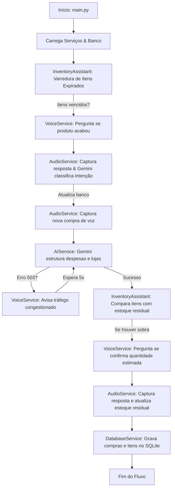

# 01 - Resumo do Sistema

Este documento apresenta uma visão geral do **Assistente Doméstico Inteligente (Versão 2.1 - V2.1)**. O sistema representa uma evolução direta da Versão 2, estabilizando funcionalidades existentes por meio de um patch corretivo que inclui resiliência a congestionamentos na API do Gemini e um sistema centralizado de logs locais.

---

## 1. Objetivo do Sistema

O objetivo central do sistema na **Versão 2.1** é **gerenciar de forma autônoma e preditiva o estoque de produtos domésticos por meio de comandos de voz interativos**. A partir de relatos informais de compras ou de baixas manuais, o sistema rastreia o consumo estimado dos itens, calcula resíduos físicos em estoque e interage ativamente via síntese de voz (TTS) para validar e atualizar as quantidades reais armazenadas no domicílio.

---

## 2. Resumo das Principais Funcionalidades

*   **Captação de Áudio com Controle Avançado de Silêncio:** Captura comandos de voz gerenciando o tempo global de execução (máximo de 120 segundos) e realizando cortes cirúrgicos de gravação após 5 segundos de silêncio real ou cancelando após 15 segundos de inatividade inicial.
*   **Transcrição de Voz (Speech-to-Text):** Conversão de fala analógica do microfone em texto por meio do serviço Speech Recognition do Google, com bips de aviso no início, no fim e alertas de término próximo.
*   **Interpretação Inteligente de Notas de Compras Multiestabelecimento:** Uso da API do Google Gemini (`gemini-2.5-flash`) com instruções para extrair informações de compras de múltiplos estabelecimentos comerciais diferentes descritas em um único comando de voz contínuo.
*   **Síntese de Voz Neural (Text-to-Speech):** Resposta por voz artificial realista e humanizada (voz masculina `pt-BR-AntonioNeural`) para fazer perguntas e confirmar o status de estoques diretamente ao usuário.
*   **Motor de Gestão Preditiva de Estoque e Consumo:** Varredura automática na inicialização para identificar itens cuja autonomia estimada expirou. No registro de novas compras, calcula o resíduo antigo baseado no tempo médio de consumo do usuário.
*   **Árvore de Decisão Conversacional de Estoque:** Motor que interpreta respostas de voz do usuário em 4 cenários:
    1.  *Confirmação:* Validação do resíduo estimado pelo sistema.
    2.  *Negativa Zerado:* O produto acabou antes da nova compra (recalcula ritmo de consumo).
    3.  *Negativa Sem Consumo:* O produto antigo não foi aberto (preserva o estoque anterior).
    4.  *Divergência de Quantidade:* Usuário informa uma quantidade real diferente (corrige o inventário e ajusta dinamicamente a taxa de consumo).
*   **Baixa Direta e Voluntária de Itens:** Permite zerar diretamente o estoque de um produto de forma voluntária, recalculando sua taxa de uso e marcando-o como esgotado no banco de dados SQLite.
*   **Resiliência a Erro 503 (Indisponibilidade do Gemini):** Tratamento do erro de indisponibilidade ou alta demanda da API do Gemini (`ServiceUnavailableException`), com loop de reenvio de 5 segundos, mantendo a transcrição salva e notificando o usuário por áudio e texto.
*   **Sistema de Log Estruturado:** Geração automática de logs detalhados, registrando o histórico de execução tanto em um arquivo geral quanto em arquivos específicos por assistente.

---

## 3. Responsabilidades Gerais

As responsabilidades no sistema estão distribuídas nos seguintes componentes:
*   **Orquestrador (`app/main.py`):** Coordena o ciclo de vida inicial, aciona o assistente de inventário e gerencia o fluxo de gravação de novas despesas e persistência relacional.
*   **Configuração (`core/config.py`):** Centraliza as variáveis de ambiente e parâmetros físicos do áudio.
*   **Serviço de Áudio (`services/audio_service.py`):** Gerencia buffers de entrada do microfone, bips sonoros e integra-se à API de transcrição do Google.
*   **Serviço de Voz (`services/voice_service.py`):** Conecta-se à API Edge TTS para gerar a voz neural e utiliza o `pygame.mixer` para reproduzi-la localmente.
*   **Serviço de Inteligência Artificial (`services/ai_service.py`):** Prepara os prompts estruturados e executa as chamadas ao modelo Gemini da Google, capturando e tratando erros de infraestrutura como falhas de cota e indisponibilidade de serviço.
*   **Serviço de Inventário (`services/inventory_assistant.py`):** Contém as regras de negócio de estoque, cálculo de autonomia preditiva e classificação lógica de intenções conversacionais via Gemini.
*   **Serviço de Banco de Dados (`services/db_service.py`):** Gerencia a persistência relacional das compras, tabelas de controle de consumo e funções genéricas de escrita/leitura SQL.
*   **Serviço de Logging (`services/logger_service.py`):** Centraliza a gravação física de logs no disco, gerenciando as pastas e arquivos de logs e garantindo a inclusão de cabeçalhos diários.

---

## 4. Visão Macro do Funcionamento

O fluxo síncrono geral do sistema na inicialização e processamento de compras ocorre de forma interativa:

---

## Evolução da V1 para V2

Abaixo está o resumo da transição evolutiva do sistema da V1 para a V2 (mantido como referência histórica):
*   **Controle de Áudio:** O módulo de áudio evoluiu de uma captação simples por temporizador fixo para um sistema inteligente com cálculo dinâmico de RMS de som, corte automático por silêncio (5s) e cancelamento por inatividade inicial (15s).
*   **Estruturação de Compras:** A IA agora é instruída a separar e retornar múltiplos estabelecimentos comerciais descritos em um único comando de voz contínuo.
*   **Interatividade por Voz (TTS):** Geração de feedback falado com voz neural realista masculina.
*   **Gestão Preditiva de Estoque:** Tabela `controle_consumo` e controle de autonomia preditiva.
*   **Árvore de Decisão de Resíduos:** Processamento conversacional em 4 vias baseadas na intenção do usuário para calcular estoque e ritmo de consumo médio.
*   **Varredura Preditiva na Inicialização:** Alerta ativo ao iniciar a aplicação para itens com estoque esgotado.

---

## Alterações da Versão 2.1

A **Versão 2.1** representa um patch corretivo e de estabilização do sistema da Versão 2, introduzindo as seguintes melhorias:

*   **Resiliência à Indisponibilidade da API do Gemini (Erro 503):** O sistema agora captura explicitamente erros de indisponibilidade temporária e alta demanda no Gemini. Ao detectar o erro `ServiceUnavailableException`, ele salva temporariamente a transcrição do áudio, avisa o usuário verbalmente ("Tráfego congestionado. Fazendo nova requisição.") e dispara uma nova tentativa após um intervalo de 5 segundos, impedindo que o sistema pare ou perca a fala gravada.
*   **Implementação de Logs em Arquivo:** Foi criado o módulo transversal `logger_service.py` que implementa um CustomLogger. Ele grava dois tipos de arquivos físicos de logs na pasta `Logs/` na raiz do projeto:
    *   *Log Geral (`Logs/main/main_log.txt`):* Registra eventos globais do sistema, como inicialização, áudios transcritos e qual assistente recebeu a demanda.
    *   *Logs dos Assistentes (`Logs/<nome_do_assistente>/log.txt`):* Logs específicos de cada módulo de serviço (como `ai_service`, `audio_service`, `db_service`, `inventory_assistant`, `shopping_assistant` e `voice_service`), detalhando suas operações individuais.
    *   *Divisores Diários:* Na primeira inicialização do dia, os arquivos recebem automaticamente um cabeçalho identificando a data (ex: `**************************** main_02/08/2026 ****************************`).
*   **Funcionalidades Novas:** Nenhuma funcionalidade de negócio nova foi criada nesta versão. O foco foi em tolerância a falhas na integração com IA e rastreabilidade através de logs.
