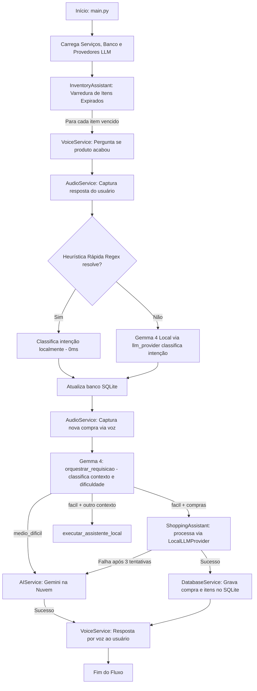

# 01 - Resumo do Sistema

Este documento apresenta uma visão geral do **Assistente Doméstico Inteligente (Versão 3 - V3)**. O sistema representa uma evolução arquitetural significativa em relação à V2.1, introduzindo um **LLM local** (Gemma 4 e:4b via Ollama) como camada primária de orquestração e processamento, reduzindo a dependência de APIs externas de IA para operações do fluxo principal.

---

## 1. Objetivo do Sistema

O objetivo central do sistema na **Versão 3** é o mesmo da V2.1: **gerenciar de forma autônoma e preditiva o estoque de produtos domésticos por meio de comandos de voz interativos**. A principal mudança desta versão é **onde e como** a inteligência artificial processa as solicitações. A V3 introduz um modelo local executado na própria máquina do usuário, tornando o sistema mais resiliente e menos dependente de conectividade com a internet para as tarefas principais.

---

## 2. Resumo das Principais Funcionalidades

*   **Captação de Áudio com Controle Avançado de Silêncio:** Captura comandos de voz gerenciando o tempo global de execução (máximo de 120 segundos), com corte automático após 5 segundos de silêncio real e cancelamento após 15 segundos de inatividade inicial.
*   **Transcrição de Voz (Speech-to-Text):** Conversão de fala analógica em texto por meio da API do Google Speech Recognition.
*   **Orquestração por LLM Local (NOVO na V3):** O Gemma 4 e:4b, executado localmente via Ollama, analisa a transcrição de voz e classifica a solicitação em: dificuldade (`facil`/`medio_dificil`), contexto (`compras`, `agenda`, `inventario`, `outro`, `geral`), ação (`criar`, `corrigir`, `consultar`, `delegar`) e mudança de contexto. Isso determina para qual assistente especializado o fluxo será roteado.
*   **Processamento Local de Compras (NOVO na V3):** O `ShoppingAssistant` utiliza o `LocalLLMProvider` (Gemma 4 e:4b via Ollama) para estruturar a fala do usuário em JSON de compras, sem depender da nuvem para esse fluxo.
*   **Classificação Local de Intenções de Estoque (NOVO na V3):** O `InventoryAssistant` utiliza uma cadeia de processamento com dois níveis: primeiramente uma heurística rápida via Regex (0ms de latência) e, caso não resolva, delega ao Gemma 4 e:4b local para classificar a intenção do usuário nos 4 cenários de inventário.
*   **Resiliência com Retry Automático (Mantido e Expandido):** O sistema possui uma camada de resiliência (`resilience_service.py`) que realiza até 3 tentativas automáticas em qualquer chamada, com aviso de voz ao usuário em caso de reprocessamento e fallback para a nuvem (Gemini) em caso de falha crítica local.
*   **Fallback para Gemini na Nuvem (Mantido):** Caso o LLM local falhe de forma persistente, o sistema tenta encaminhar a solicitação para a API do Gemini como contingência.
*   **Síntese de Voz Neural (Text-to-Speech):** Resposta por voz artificial realista com voz masculina `pt-BR-AntonioNeural` via Microsoft Edge TTS.
*   **Motor de Gestão Preditiva de Estoque:** Varredura automática na inicialização para identificar itens com autonomia estimada esgotada, com cálculo de resíduos e atualização dinâmica da taxa de consumo.
*   **Árvore de Decisão Conversacional de Estoque (4 cenários):** Confirmação, Negativa Zerado, Negativa Sem Consumo, Divergência de Quantidade.
*   **Baixa Direta e Voluntária de Itens:** Zeramento manual de estoque com resolução de ambiguidade por voz.
*   **Sistema de Log Estruturado:** Logs persistentes em disco, segmentados por módulo, com cabeçalhos diários.

---

## 3. Responsabilidades Gerais

*   **Orquestrador (`app/main.py`):** Inicializa serviços, coordena o ciclo de execução, gerencia o roteamento de solicitações entre os assistentes e implementa a lógica de retry via `execute_with_retry`.
*   **Serviço Gemma (`services/gemma_service.py`):** Realiza a chamada direta ao Ollama para orquestração de intenções. Valida o schema de saída do modelo e lança exceções estruturadas em caso de falha.
*   **Provedores LLM (`services/llm_provider.py`):** Camada de abstração com interface `BaseLLMProvider`. Implementa `LocalLLMProvider` (Gemma via Ollama) e `CloudLLMProvider` (Gemini via AIService).
*   **Serviço de Resiliência (`services/resilience_service.py`):** Módulo de retry parametrizável, com suporte a callbacks de validação, avisos de voz em reprocessamento e exceções estruturadas.
*   **Assistente de Compras (`services/shopping_assistant.py`):** Processa transcrições de compras de voz, estrutura os dados em JSON via LLM local e persiste no banco.
*   **Assistente de Inventário (`services/inventory_assistant.py`):** Gerencia a lógica de controle preditivo de estoque, com classificação de intenções via heurística local + Gemma 4 e:4b.
*   **Configuração (`core/config.py`):** Centraliza variáveis de ambiente, caminhos do banco e parâmetros de áudio.
*   **Serviço de Áudio (`services/audio_service.py`):** Captura de microfone com monitoramento de RMS, bips sonoros e controle de silêncio.
*   **Serviço de Voz (`services/voice_service.py`):** Síntese de voz neural via Edge TTS e reprodução com `pygame.mixer`.
*   **Serviço de Banco de Dados (`services/db_service.py`):** Persistência relacional via SQLite com suporte a migrações por schema version.
*   **Serviço de Logging (`services/logger_service.py`):** Logger transversal com arquivos separados por módulo e cabeçalhos diários.

---

## 4. Visão Macro do Funcionamento (V3)

---

## 5. Principais Alterações em Relação à V2.1

*   **Implantação do LLM Local (Gemma 4 e:4b via Ollama):** Principal mudança da V3. O Gemma atua agora como orquestrador de intenções e como extrator de dados de compras no fluxo principal.
*   **Nova Camada de Abstração de LLM (`llm_provider.py`):** Interface unificada `BaseLLMProvider` com duas implementações: `LocalLLMProvider` (Ollama) e `CloudLLMProvider` (Gemini).
*   **Novo Serviço de Resiliência (`resilience_service.py`):** Retry parametrizável centralizado, substituindo a lógica de retry inline que existia no `main.py` da V2.1.
*   **Novo Serviço de Orquestração Local (`gemma_service.py`):** Módulo dedicado às chamadas de orquestração ao Ollama, com validação de schema e sanitização de resposta.
*   **Heurística Rápida no InventoryAssistant:** Antes de chamar qualquer LLM, o sistema tenta resolver a intenção do usuário via Regex/padrões de texto em ~0ms.
*   **Sessão de Contexto no Orquestrador:** `GerenciadorDeSessao` mantém o contexto da conversa e o histórico de mensagens entre as interações.
