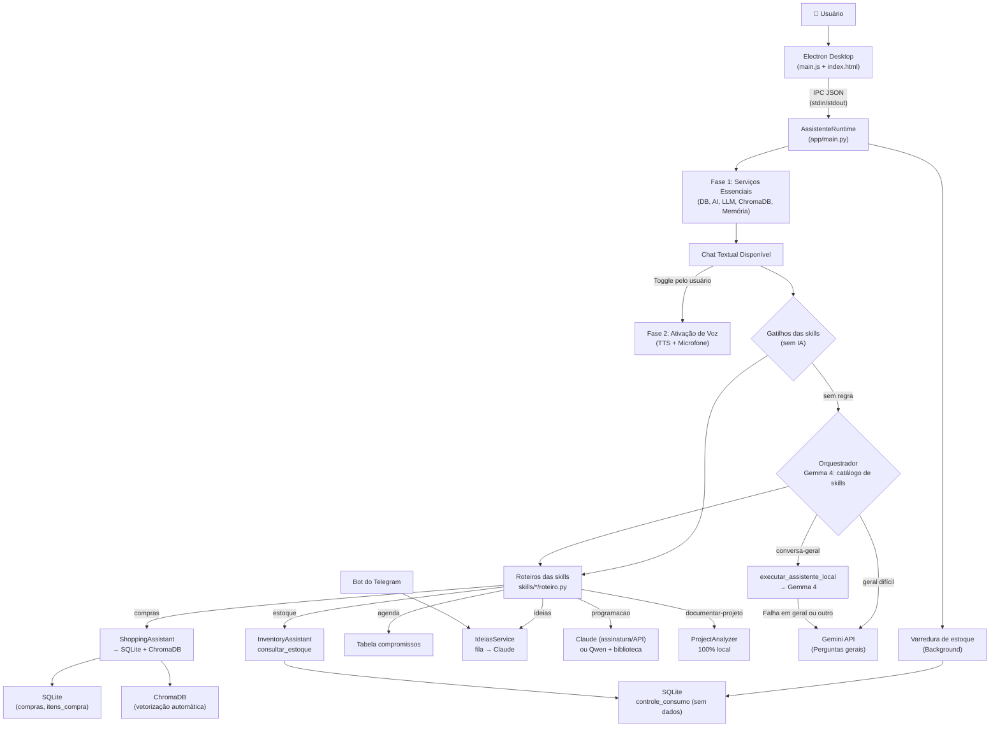

# 01 - Resumo do Sistema

Este documento apresenta uma visão geral do **Assistente Doméstico Inteligente (Versão 4.1 - V4.1, atualizado em 23/11/2026)**. A V4 trouxe a base descrita abaixo; a V4.1 reorganizou o sistema em **skills** escolhidas por catálogo e acrescentou agenda, ideias de projetos analisadas pelo Claude e um bot do Telegram (seção 2.1). O sistema representa uma evolução arquitetural significativa em relação à V3, introduzindo uma **Interface Gráfica Desktop via Electron**, um **Banco Vetorial (ChromaDB)** com **embeddings locais na CPU**, **Memória Semântica de Longo Prazo**, um **Modo Qwen** para programação, a **Skill ProjectAnalyzer** e um modelo de inicialização **Text-First** com ativação dinâmica de voz.

> [!IMPORTANT]
> A gestão preditiva de estoque ainda não funciona de ponta a ponta, porque as compras gravadas não alimentam `controle_consumo`. A situação real de cada funcionalidade está em `08 - Estado Atual da V4.md`.

---

## 1. Objetivo do Sistema

O objetivo central do sistema na **Versão 4** permanece: **gerenciar de forma autônoma e preditiva o estoque de produtos domésticos por meio de interações em linguagem natural**. A V4 evolui o modo de interação ao introduzir uma **interface gráfica desktop (Electron)** com chat textual, tornando o sistema acessível sem depender de hardware de áudio. Além disso, a V4 habilita **capacidade de recuperação semântica e memória de longo prazo** via banco vetorial ChromaDB, complementando o SQLite relacional em uma **arquitetura de persistência híbrida**.

---

## 2. Resumo das Principais Funcionalidades

*   **Interface Gráfica Desktop (NOVO na V4):** Aplicação Electron com janela nativa Windows, chat bidirecional (texto), painel lateral de controles, terminal de debug interno e comunicação IPC bidirecional (Renderer ↔ Main ↔ Python).
*   **Modelo de Inicialização Text-First (NOVO na V4):** O chat textual não depende de hardware de áudio. Desde a V4.1, fica pronto em cerca de 3,5 s, porque o modelo de embeddings carrega em segundo plano. Hardware de voz (microfone + TTS) é ativado sob demanda via toggle na interface, sem bloquear o modo texto.
*   **Modo Qwen (NOVO na V4 — parcial):** Comandos como `ativar qwen` trocam o modelo ativo para `qwen2.5-coder:7b`; `voltar gemma` retorna ao padrão. A troca ocorre por frases exatas, sem botão na interface.
*   **Skill ProjectAnalyzer (NOVO na V4):** Analisa projetos e gera documentação técnica localmente (ver documento 07).
*   **Banco Vetorial ChromaDB (NOVO na V4):** Persistência vetorial local em `core/database/chroma_db` com coleção `assistente_domestico_memory`, utilizando espaço de similaridade por cosseno e operações idempotentes (upsert/delete/count).
*   **Embeddings Locais na CPU (NOVO na V4):** Geração de vetores via `sentence-transformers` (modelo `paraphrase-multilingual-MiniLM-L12-v2`) operando exclusivamente na CPU, preservando a VRAM/GPU para os modelos generativos Ollama.
*   **Memória Semântica de Longo Prazo (NOVO na V4):** Serviço de memória (`MemoryService`) que avalia e filtra automaticamente interações irrelevantes (saudações, interjeições), persistindo apenas fatos, preferências e observações relevantes no banco vetorial.
*   **Busca Semântica Híbrida (NOVO na V4 — não ligada ao fluxo):** Mecanismo que localiza itens semanticamente equivalentes no ChromaDB e hidrata valores exatos do SQLite. Hoje é usado apenas por `scripts/validate_vector_database.py`.
*   **Recuperação de Contexto RAG (NOVO na V4):** Montador de contexto (`ContextRetrievalService`) que formata blocos de memória semântica, injetado nas instruções do assistente local genérico e do Gemini.
*   **Consulta de Estoque por Texto (NOVO na V4 — parcial):** Perguntas como "ainda tenho leite?" são respondidas com a estimativa do estoque restante a partir de `controle_consumo`. Como essa tabela ainda não é preenchida pelas compras, a resposta atual é de estoque vazio. Alterações de estoque por texto ainda não estão disponíveis.
*   **Vetorização Automática de Compras (NOVO na V4):** Cada item de compra registrado no SQLite via `ShoppingAssistant` é automaticamente vetorizado no ChromaDB, criando representação semântica em linguagem natural.
*   **Captação de Áudio com Controle Avançado de Silêncio:** Captura comandos de voz gerenciando o tempo global de execução (máximo de 120 segundos), com corte automático após 5 segundos de silêncio real e cancelamento após 15 segundos de inatividade inicial.
*   **Transcrição de Voz (Speech-to-Text):** Conversão de fala analógica em texto por meio da API do Google Speech Recognition.
*   **Orquestração por LLM Local (alterada na V4.1):** O Gemma 4 E4B, local via Ollama, escolhe a skill a partir do catálogo (`skills/*/SKILL.md`), com saída restrita por JSON Schema: skill, ação e dificuldade. No PC, foram 44/48 acertos em 0,87 s.
*   **Processamento Local de Compras (Mantido da V3):** O `ShoppingAssistant` utiliza o `LocalLLMProvider` (Gemma 4 e:4b via Ollama) para estruturar a fala do usuário em JSON de compras.
*   **Classificação Local de Intenções de Estoque (Mantido da V3):** O `InventoryAssistant` utiliza heurística rápida via Regex e, caso não resolva, delega ao Gemma 4 e:4b local.
*   **Resiliência com Retry Automático (Mantido da V3):** Camada de resiliência (`resilience_service.py`) com até 3 tentativas automáticas e fallback para a nuvem (Gemini).
*   **Gemini para Perguntas Gerais (Alterado na V4):** Somente perguntas gerais podem ir à nuvem, quando são difíceis ou o LLM local falha. Compras, estoque, agenda e documentação ficam locais. A chave do Gemini é opcional.
*   **Claude para Programação e Ideias (V4.1):** só as skills `programacao` e `ideias` podem mandar texto ao Claude (`CLAUDE_SKILLS`). O padrão usa a assinatura do usuário pelo Claude Code (`claude -p`, sem ferramentas e sem chave de API); o modo API continua disponível. Sem Claude, a programação usa o Qwen local com a biblioteca de contexto.
*   **Roteamento por Regras (NOVO na V4):** Frases conhecidas são encaminhadas sem IA; o orquestrador classifica apenas os casos ambíguos. Desde a V4.1, as regras são os `gatilhos` dos cabeçalhos das skills, avaliados em ordem de prioridade.
*   **Confirmação e Desfazer Compras (NOVO na V4):** Compras com dúvida (mercado, preço, total, data ou embalagem) aguardam "sim" ou "não". O comando "desfazer última compra" remove o último registro da sessão.
*   **Síntese de Voz Neural (Text-to-Speech):** Resposta por voz artificial com voz `pt-BR-AntonioNeural` via Microsoft Edge TTS.
*   **Motor de Gestão Preditiva de Estoque (sem dados):** Varredura automática em background na inicialização para identificar itens com autonomia estimada esgotada. Sem registros em `controle_consumo`, não há itens a avaliar.
*   **Árvore de Decisão Conversacional de Estoque (4 cenários — não ligada ao fluxo):** Confirmação, Negativa Zerado, Negativa Sem Consumo, Divergência de Quantidade. O código existe, mas `processar_estoque_nova_compra` não tem chamadas.
*   **Baixa Direta e Voluntária de Itens (não ligada ao fluxo):** Zeramento manual de estoque com resolução de ambiguidade. O código existe, mas `registrar_fim_estoque_direto` não tem chamadas.
*   **Registro de Eventos Estruturado (M26, 22/11/2026):** uma linha JSON por evento em `Logs/eventos-AAAA-MM-DD.jsonl`, com identificador da requisição, tempo por etapa e retenção de 30 dias. As tags semânticas (`[EMBEDDING]`, `[VECTOR_STORE]`, `[MEMORY]`...) continuam no texto das mensagens.
*   **Cópia de Segurança Automática (M11, 22/11/2026):** SQLite e ChromaDB copiados uma vez por dia, com verificação de integridade e retenção de 7 diárias e 4 semanais.

## 2.1. Funcionalidades da V4.1 (fase das skills, 23/11/2026)

*   **Skills:** cada capacidade é uma pasta em `skills/<nome>/` com `SKILL.md` (cabeçalho YAML com contexto, privacidade, gatilhos), prompts em Markdown e, quando há fluxo fixo, um `roteiro.py`. Skills atuais: `compras`, `estoque`, `agenda`, `ideias`, `programacao`, `documentar-projeto` e `conversa-geral`.
*   **Fábrica de skills:** `scripts/nova_skill.py` cria uma skill a partir de `skills/_modelo`; `scripts/validar_skills.py` roda na integração contínua.
*   **Agenda:**
    *   Anota compromissos: o modelo local extrai título, data e hora.
    *   Consulta hoje, amanhã, a semana, um dia ou uma data, e cancela o último compromisso, com confirmação.
    *   Fica no SQLite local. Ainda não avisa na hora do compromisso.
*   **Ideias de projetos:**
    *   "Tive uma ideia: ..." salva a ideia na hora.
    *   O Claude analisa em segundo plano: título, resumo, MVP, como construir, riscos, próximos passos e perguntas.
    *   A análise fica no banco e em `Ideias/*.md` (fora do Git), que entra na biblioteca local.
    *   "Como sigo a ideia X?" é respondida pelo modelo local, sem internet.
*   **Bot do Telegram (opcional):**
    *   Ideias mandadas do celular são salvas e a análise volta ao chat.
    *   Atende só os chats de `TELEGRAM_CHAT_IDS`; perguntas e pedidos não são salvos.
    *   Não expõe o PC: busca as mensagens por long polling.
*   **Biblioteca de contexto:** a documentação do projeto e as análises de ideias ficam indexadas no ChromaDB (coleção `biblioteca_projeto`). Só os trechos relevantes vão ao modelo.
*   **Encaminhamento entre skills:** um roteiro pode devolver o pedido à conversa geral, por exemplo quando "me dê ideias de..." não fala de uma ideia salva.
*   **Inicialização por `.bat`:** `iniciar-assistente.bat` abre o Ollama se preciso e inicia o app; `instalar-claude-code.bat` instala e confere o Claude Code.

---

## 3. Responsabilidades Gerais

*   **Processo Electron Main (`main.js`):** Ponto de entrada do desktop. Cria a `BrowserWindow`, inicia o back-end Python como processo filho (`spawn`), gerencia a comunicação IPC bidirecional (JSON via stdin/stdout) e implementa shutdown graceful.
*   **Electron Preload (`preload.js`):** Expõe a API segura `window.api` no `contextBridge` para comunicação entre o Renderer e o Main Process via `ipcRenderer`.
*   **Renderer (`renderer.js` + `index.html` + `index.css`):** Interface visual do chat, controles de voz/mute, terminal de debug, gerenciamento de estado e renderização de mensagens.
*   **Orquestrador Python (`app/main.py`):** `AssistenteRuntime` — Inicializa serviços em duas fases (Text-First), gerencia o event loop principal via `queue.Queue`, coordena threads de stdin e microfone, roteia fluxo entre assistentes e implementa shutdown graceful.
*   **Serviço Gemma (`services/gemma_service.py`):** Orquestração pelo catálogo de skills (prompt fixo e JSON Schema) e assistente local da conversa geral.
*   **Catálogo e motor de skills (`core/skills/`):** lê `skills/*/SKILL.md`, aplica os gatilhos, monta a decisão do orquestrador e executa o `roteiro.py` de cada skill com os serviços que o núcleo entrega.
*   **Claude (`services/claude_service.py`, `services/claude_assinatura_service.py`):** API da Anthropic ou Claude Code pela assinatura, com controle de disponibilidade, reteste e limite mensal (API).
*   **Ideias (`services/ideias_service.py`) e Telegram (`services/telegram_service.py`):** fila de análise das ideias e bot do celular.
*   **Biblioteca (`services/biblioteca_service.py`):** indexação incremental da documentação para dar contexto à programação.
*   **Provedores LLM (`services/llm_provider.py`):** Abstração `BaseLLMProvider` com `LocalLLMProvider` (Gemma via Ollama) e `CloudLLMProvider` (Gemini via AIService).
*   **Serviço de Resiliência (`services/resilience_service.py`):** Retry parametrizável com callbacks de validação e alertas de voz.
*   **Assistente de Compras (`services/shopping_assistant.py`):** Processa transcrições de compras, estrutura JSON via LLM, persiste no SQLite e vetoriza automaticamente no ChromaDB.
*   **Assistente de Inventário (`services/inventory_assistant.py`):** Controle preditivo de estoque com heurística Regex + Gemma 4 local.
*   **Pacote Vetorial (`services/vector/`):** Contém os 5 serviços da arquitetura vetorial e RAG — `EmbeddingService`, `VectorStoreService`, `MemoryService`, `SemanticSearchService` e `ContextRetrievalService`.
*   **Configuração (`core/config.py`):** Centraliza variáveis de ambiente, caminhos do banco relacional e vetorial, nome do modelo de embeddings.
*   **Serviço de Banco de Dados (`services/db_service.py`):** Persistência relacional via SQLite com migrações por `PRAGMA user_version`.
*   **Serviço de Áudio (`services/audio_service.py`):** Captura de microfone com RMS, bips e controle de silêncio.
*   **Serviço de Voz (`services/voice_service.py`):** Síntese neural via Edge TTS e reprodução com `pygame.mixer`.
*   **Serviço de Logging (`services/logger_service.py`):** Logger transversal sobre o `logging` padrão: JSON por linha, identificador de requisição, etapas medidas e opção de omitir o texto do usuário.
*   **Serviço de Cópia de Segurança (`services/backup_service.py`):** Cópia diária do banco e do banco vetorial, com manifesto e retenção.

---

## 4. Visão Macro do Funcionamento (V4)

---

## 5. Principais Alterações em Relação à V3

*   **Interface Gráfica Desktop (Electron):** A V3 operava exclusivamente via linha de comando e voz. A V4 introduz uma aplicação Electron completa com chat textual, painel de controles e terminal de debug.
*   **Modelo de Inicialização Text-First:** Na V3, o sistema dependia de hardware de áudio para funcionar. Na V4, o chat textual é disponibilizado imediatamente, e o áudio é ativado sob demanda.
*   **Comunicação IPC (Electron ↔ Python):** Protocolo JSON bidirecional via stdin/stdout entre o processo Electron (JavaScript/Node.js) e o back-end Python.
*   **Arquitetura de Persistência Híbrida (SQLite + ChromaDB):** Na V3, toda persistência era relacional. A V4 adiciona o banco vetorial ChromaDB como segunda camada de armazenamento.
*   **Novo Pacote de Serviços Vetoriais (`services/vector/`):** 5 novos módulos: `EmbeddingService`, `VectorStoreService`, `MemoryService`, `SemanticSearchService`, `ContextRetrievalService`.
*   **Vetorização Automática de Compras:** O `ShoppingAssistant` agora grava simultaneamente no SQLite e no ChromaDB.
*   **Scripts de Gestão Vetorial (`scripts/`):** Migração (`migrate_vector_database.py`), reconstrução (`rebuild_embeddings.py`), validação (`validate_vector_database.py`) e inspeção (`inspect_vector_database.py`).
*   **Tags de Log Estruturadas:** Novas tags `[EMBEDDING]`, `[VECTOR_STORE]`, `[SEMANTIC_SEARCH]`, `[MEMORY]`, `[RAG]` para observabilidade.
