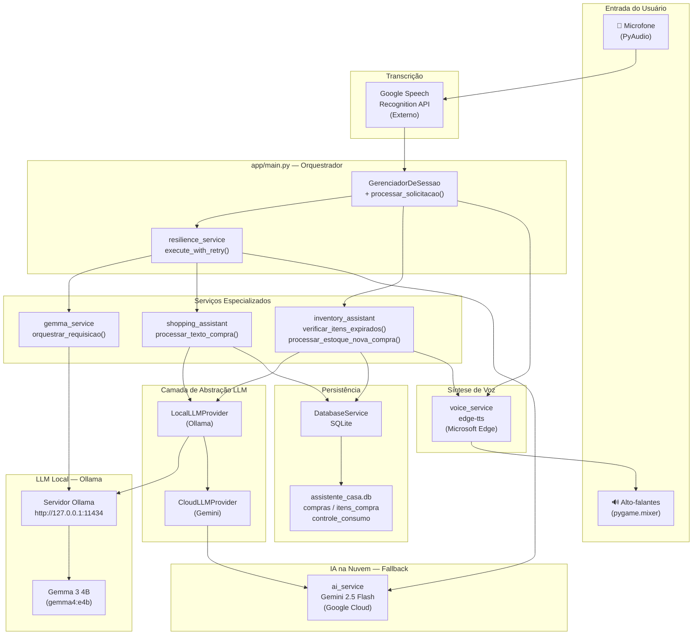
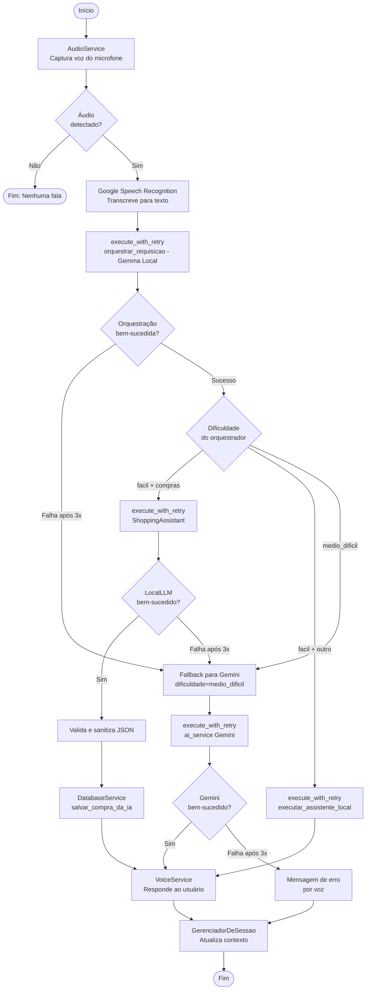
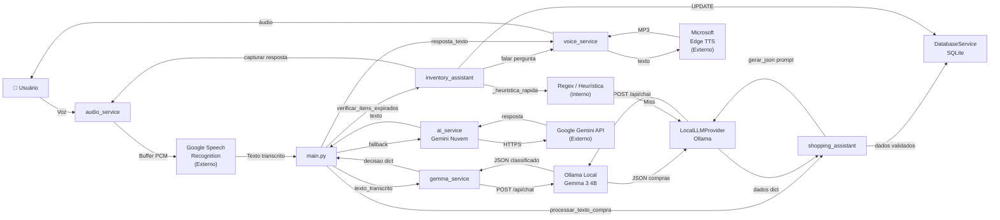
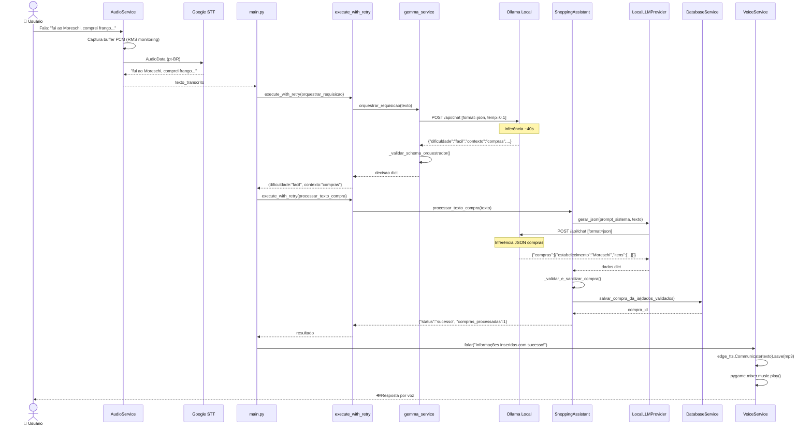
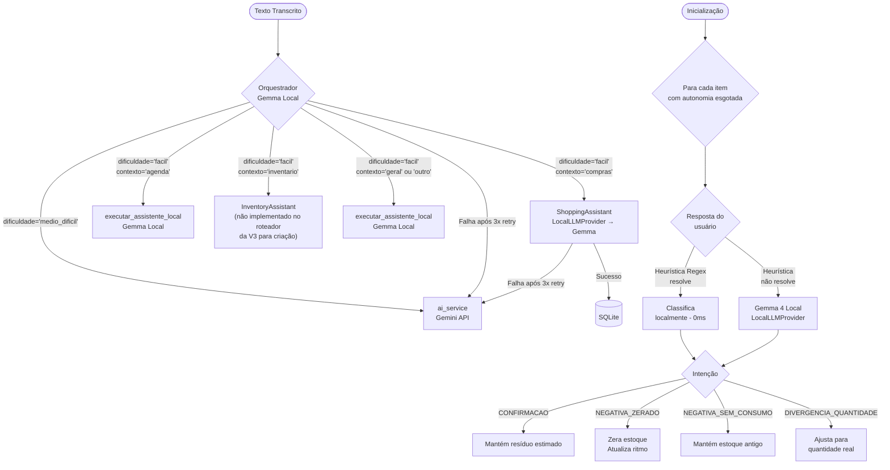

# 05 - Engenharia do Software

Este documento apresenta os diagramas técnicos de arquitetura, comunicação, fluxo e sequência do **Assistente Doméstico Inteligente (V3)**.

> [!NOTE]
> Todos os diagramas abaixo foram construídos a partir da análise direta do código-fonte da V3. Os componentes e fluxos representados refletem o estado real do sistema.

---

## 1. Diagrama de Arquitetura — Componentes Principais

---

## 2. Diagrama de Fluxo — Processamento de uma Solicitação

---

## 3. Diagrama de Comunicação — Relações entre Componentes

---

## 4. Diagrama de Sequência — Execução Típica (Registro de Compra)

---

## 5. Diagrama de Bifurcações — Pontos de Decisão do Sistema

---

## 6. Padrões de Engenharia Identificados no Código

| Padrão | Onde é aplicado | Finalidade |
|--------|-----------------|------------|
| **Strategy Pattern** | `llm_provider.py` (`BaseLLMProvider`) | Permite trocar o provedor LLM (local/nuvem) sem alterar os assistentes |
| **Dependency Injection** | `main.py` → `ShoppingAssistant`, `InventoryAssistant` | Provedores LLM são injetados externamente, facilitando testes e troca |
| **Retry Pattern** | `resilience_service.execute_with_retry` | Resiliência uniforme a falhas em qualquer chamada de LLM |
| **Fallback Chain** | `main.py`: Local → Gemini Nuvem | Garantia de processamento mesmo com falha do modelo local |
| **Chain of Responsibility** | `InventoryAssistant`: Regex → Gemma | Processamento progressivo, do mais rápido para o mais custoso |
| **Session Management** | `GerenciadorDeSessao` em `main.py` | Manutenção de contexto e histórico entre interações |
| **Schema Validation** | `gemma_service._validar_schema_orquestrador` | Contrato rígido de saída do LLM orquestrador |
| **Sanitization Pipeline** | `_sanitizar_resposta_json` (em múltiplos módulos) | Remove marcações Markdown residuais do LLM antes do parse |
