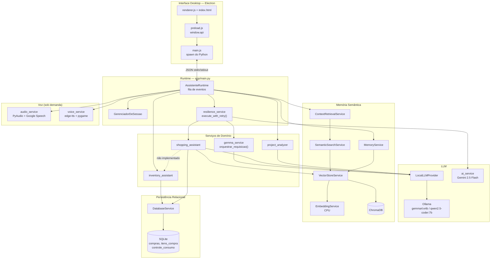
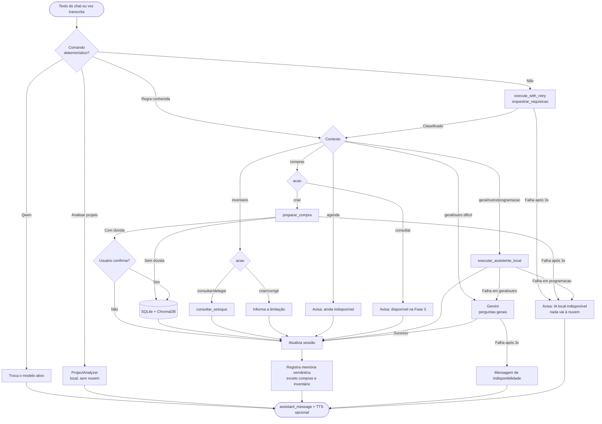
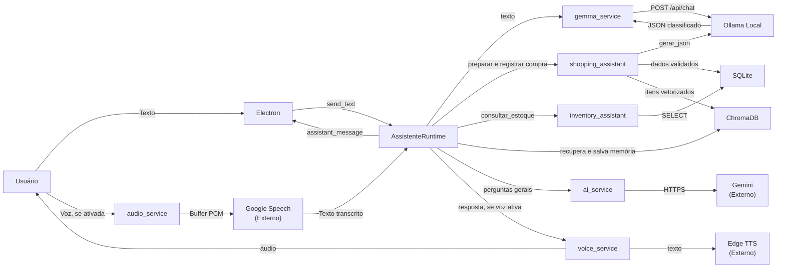
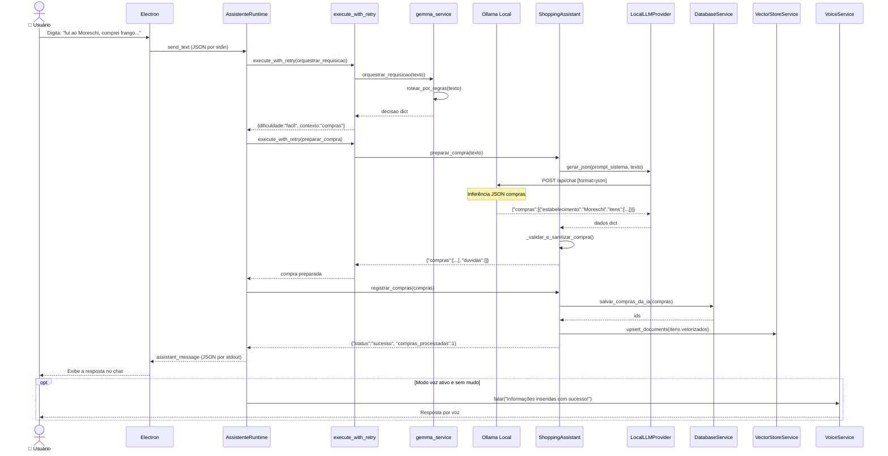
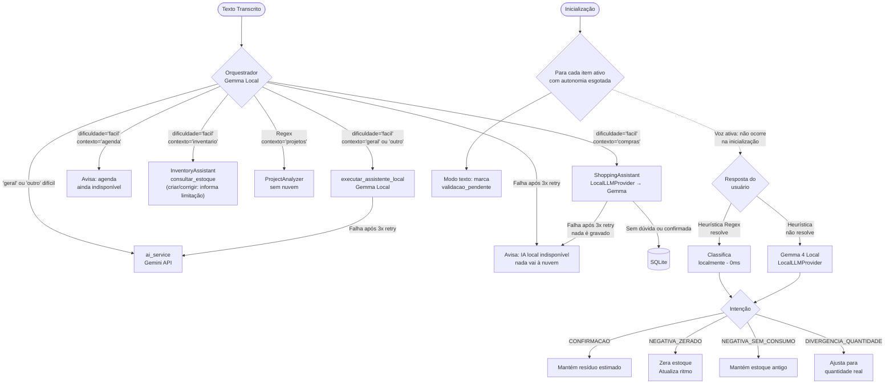

# 05 - Engenharia do Software

Este documento apresenta os diagramas técnicos de arquitetura, comunicação, fluxo e sequência do **Assistente Doméstico Inteligente (V4)**.

> [!NOTE]
> Os diagramas abaixo foram revisados a partir do código-fonte da V4 em 03/11/2026 (commit `c754a6a`). Linhas tracejadas indicam código existente que não é acionado pelo fluxo atual.

---

## 1. Diagrama de Arquitetura — Componentes Principais

---

## 2. Diagrama de Fluxo — Processamento de uma Solicitação

---

## 3. Diagrama de Comunicação — Relações entre Componentes

---

## 4. Diagrama de Sequência — Execução Típica (Registro de Compra)

---

## 5. Diagrama de Bifurcações — Pontos de Decisão do Sistema

---

## 6. Padrões de Engenharia Identificados no Código

| Padrão | Onde é aplicado | Finalidade |
|--------|-----------------|------------|
| **Strategy Pattern** | `llm_provider.py` (`BaseLLMProvider`) | Permite trocar o provedor LLM (local/nuvem) sem alterar os assistentes |
| **Dependency Injection** | `app/main.py` → `ShoppingAssistant`, `InventoryAssistant` | Provedores LLM são injetados externamente, facilitando testes e troca |
| **Retry Pattern** | `resilience_service.execute_with_retry` | Resiliência uniforme a falhas em qualquer chamada de LLM |
| **Fallback Chain** | `app/main.py`: Local → Gemini, só em `geral` e `outro` | Contingência sem enviar dados restritos à nuvem |
| **Chain of Responsibility** | `orquestrar_requisicao` e `InventoryAssistant`: regras → LLM | Processamento progressivo, do mais rápido para o mais custoso |
| **Session Management** | `GerenciadorDeSessao` em `app/main.py` | Manutenção de contexto e histórico entre interações |
| **Schema Validation** | `gemma_service._validar_schema_orquestrador` | Contrato rígido de saída do LLM orquestrador |
| **Sanitization Pipeline** | `_sanitizar_resposta_json` (em múltiplos módulos) | Remove marcações Markdown residuais do LLM antes do parse |
| **Event Loop com Fila** | `AssistenteRuntime.rodar` | Processa comandos do chat, voz e controles em uma única sequência |
| **Bridge Seguro** | `preload.js` (`contextBridge`) | Expõe ao renderer apenas a API necessária |
| **Inicialização Lazy** | `VoiceService`, `AudioService` | Só acessa o hardware quando o modo voz é ativado |
| **Singleton** | `EmbeddingService`, `VectorStoreService` | Evita recarregar o modelo e reabrir o cliente ChromaDB |
| **Fachada** | `ProjectAnalyzer` | Coordena varredura, extração, LLM local e documentação |
| **Índice Incremental** | `index_cache.py` | Reanalisa apenas arquivos com hash alterado |
