# 05 - Engenharia de Software

Este documento detalha os aspectos de Engenharia de Software aplicados na **Versão 2 (V2)** do **Assistente Doméstico Inteligente**, descrevendo o padrão arquitetural em camadas, a gestão de dados, as dependências internas e externas, e apresenta o diagrama arquitetural atualizado.

---

## 1. Arquitetura em Camadas

O sistema adota uma **Arquitetura Modular em Camadas**, estruturada para desacoplar as regras de negócios locais das APIs em nuvem e dos drivers de hardware. As quatro camadas da V2 estão organizadas da seguinte forma:

### A. Camada de Orquestração (Entrypoint)
*   **Módulo:** [main.py](file:///e:/Agente%20IA/assistente-domestico/app/main.py)
*   **Responsabilidade:** Inicialização do sistema, configuração do escopo de importação global (`sys.path`), gerenciamento de exceções não tratadas e controle de encerramento. Funciona como um orquestrador síncrono pura que coordena o fluxo de execução chamando os serviços correspondentes.

### B. Camada de Inteligência e Lógica de Negócios
*   **Módulo:** [inventory_assistant.py](file:///e:/Agente%20IA/assistente-domestico/services/inventory_assistant.py)
*   **Responsabilidade:** Implementar a lógica de inventário de despesas e controle preditivo de estoque doméstico. Ela calcula autonomias estimadas de consumo (relação de dias por quantidade), avalia resíduos e implementa a árvore conversacional de tomada de decisão baseada na resposta de voz do usuário.

### C. Camada de Serviços Técnicos (Integrações e Hardware)
*   **Módulos:** 
    *   [audio_service.py](file:///e:/Agente%20IA/assistente-domestico/services/audio_service.py): Gerencia a captação analógica do microfone, bips sonoros e analisa a amplitude RMS para cortes inteligentes por silêncio.
    *   [voice_service.py](file:///e:/Agente%20IA/assistente-domestico/services/voice_service.py): Recebe textos, solicita a geração de áudio neural na API Edge TTS, controla a reprodução de som local através do mixer e descarta o áudio gerado.
    *   [ai_service.py](file:///e:/Agente%20IA/assistente-domestico/services/ai_service.py): Prepara e otimiza os prompts do Gemini para converter frases livres de compras em objetos JSON estruturados.
    *   [db_service.py](file:///e:/Agente%20IA/assistente-domestico/services/db_service.py): Centraliza as queries SQL do SQLite para persistência relacional de dados de compras, itens e estoque.

### D. Camada Core (Infraestrutura de Apoio)
*   **Módulo:** [config.py](file:///e:/Agente%20IA/assistente-domestico/core/config.py)
*   **Responsabilidade:** Fornecer suporte básico de configuração carregando o arquivo `.env` para a memória do processo, mapear caminhos físicos globais e assegurar a existência dos diretórios de banco de dados locais.

---

## 2. Fluxo das Informações (Entradas e Saídas)

O sistema possui pontos de entrada e saída bem delimitados que refletem o processamento físico e lógico das informações:

*   **Pontos de Entrada (Inputs):**
    *   *Sinais Analógicos de Áudio:* Capturados via microfone físico (`audio_service.py`).
    *   *Parâmetros e Variáveis:* Lidos do arquivo local `.env` (`config.py`).
    *   *Dados de Consulta Relacional:* Tabelas do banco `assistente_casa.db` (`db_service.py`).
    *   *Retornos de APIs (JSON e Streams):* Transcrição do Google, JSON estruturado do Gemini e stream de voz em MP3 do Edge TTS.
*   **Pontos de Saída (Outputs):**
    *   *Áudio Analógico (Fala do Assistente):* Saída emitida nos alto-falantes do computador pelo mixer (`voice_service.py`).
    *   *Bips do Sistema:* Sinais sonoros emitidos na placa de som (`audio_service.py`).
    *   *Persistência Física:* Gravações relacionais estruturadas no arquivo local SQLite (`db_service.py`).
    *   *Mensagens de Logs:* Rastreamento formatado impresso no console (`logging`).

---

## 3. Diagrama Arquitetural V2 (Mermaid)

O diagrama a seguir descreve com precisão as comunicações e dependências entre os componentes reais que operam no ecossistema da Versão 2:

```mermaid
graph TD
    %% Camada de Apresentação e Orquestração
    subgraph Orchestration ["Orquestração (Ponto de Entrada)"]
        CLI["Linha de Comando (app/main.py)"]
    end

    %% Camada de Negócio e Serviços
    subgraph Services ["Camada de Serviços & Regras de Negócio"]
        InvSvc["Assistente de Estoque (services/inventory_assistant.py)"]
        AudioSvc["Captura de Áudio (services/audio_service.py)"]
        VoiceSvc["Síntese de Voz (services/voice_service.py)"]
        AISvc["Estruturação de Texto (services/ai_service.py)"]
        DBSvc["Persistência Relacional (services/db_service.py)"]
    end

    %% Camada Core
    subgraph Core ["Configuração & Core"]
        Config["Configurações Globais (core/config.py)"]
    end

    %% Recursos Externos e Hardware
    subgraph Hardware ["Hardware Local"]
        Mic["Microfone Físico (Entrada)"]
        Speaker["Alto-falantes / Mixer (Saída)"]
        BipSound["Placa de Som (Bips)"]
    end

    subgraph APIs ["APIs em Nuvem (SaaS)"]
        GoogleSpeech["Google Speech API"]
        GoogleGemini["Google Gemini API (gemini-2.5-flash)"]
        EdgeTTS["Microsoft Edge TTS API"]
    end

    subgraph DB ["Banco de Dados"]
        SqliteDB[("SQLite (assistente_casa.db)")]
    end

    %% Relacionamentos e Fluxo de Dados
    CLI -->|1. Inicializa / Consulta| DBSvc
    CLI -->|2. Executa Varredura Preditiva| InvSvc
    CLI -->|3. Grava Compras de Voz| AudioSvc
    CLI -->|4. Salva Compra Relacional| DBSvc

    InvSvc -->|Acessa e Atualiza Estoque| DBSvc
    InvSvc -->|Fala Pergunta de Estoque| VoiceSvc
    InvSvc -->|Ouve Resposta do Usuário| AudioSvc
    InvSvc -->|Classifica Intenção Conversacional| GoogleGemini

    AudioSvc -->|Lê Buffer de Entrada| Mic
    AudioSvc -->|Envia Gravação de Áudio| GoogleSpeech
    GoogleSpeech -->|Retorna Texto Transcrito| AudioSvc
    AudioSvc -->|Emite Feedback Auditivo| BipSound

    VoiceSvc -->|Gera Voz Neural de Texto| EdgeTTS
    EdgeTTS -->|Retorna Stream MP3| VoiceSvc
    VoiceSvc -->|Reproduz Som Falado| Speaker

    AISvc -->|Envia Texto Bruto de Compras| GoogleGemini
    GoogleGemini -->|Retorna Compras Estruturadas JSON| AISvc
    CLI -.->|Usa para Normalizar| AISvc

    DBSvc -->|Leitura e Escrita Relacional| SqliteDB
    Config -.->|Fornece Paths e Credenciais| CLI
    Config -.->|Fornece Params de Áudio| AudioSvc

    %% Estilos Visuais
    style CLI fill:#f9f,stroke:#333,stroke-width:2px
    style InvSvc fill:#ffb,stroke:#333,stroke-width:2px
    style SqliteDB fill:#9f9,stroke:#333,stroke-width:2px
    style GoogleGemini fill:#9bf,stroke:#333,stroke-width:1px
    style EdgeTTS fill:#9bf,stroke:#333,stroke-width:1px
    style GoogleSpeech fill:#9bf,stroke:#333,stroke-width:1px
```

---

## 4. Inconsistências e Pontos de Atenção Identificados na V2

Como arquiteto técnico sênior, identificou-se uma discrepância relevante entre o código-fonte de inicialização e o banco físico na V2:

> [!WARNING]
> **Inconsistência de Esquema SQL em Tempo de Execução:**
> O método `initialize_database()` em [db_service.py](file:///e:/Agente%20IA/assistente-domestico/services/db_service.py) cria a tabela `controle_consumo` sem as colunas `ultima_qtd_comprada` e `quantidade_residual_esgotada`.
>
> Contudo, o arquivo físico pré-existente do banco de dados (`assistente_casa.db`) já possui essas colunas injetadas, e o arquivo [inventory_assistant.py](file:///e:/Agente%20IA/assistente-domestico/services/inventory_assistant.py) realiza updates diretos apontando para elas.
>
> **Impacto:** Se o arquivo de banco de dados for deletado ou inicializado em um novo computador, a aplicação falhará com erro de SQL (`no such column`), uma vez que a criação da tabela não contempla essas duas colunas. Recomenda-se corrigir a query de criação de tabela em futuras versões.
