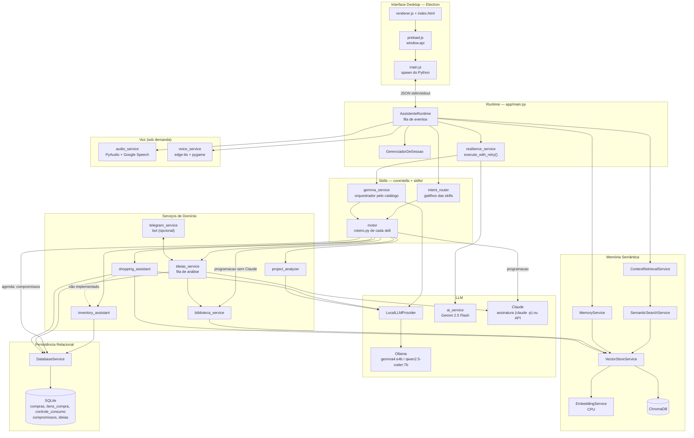
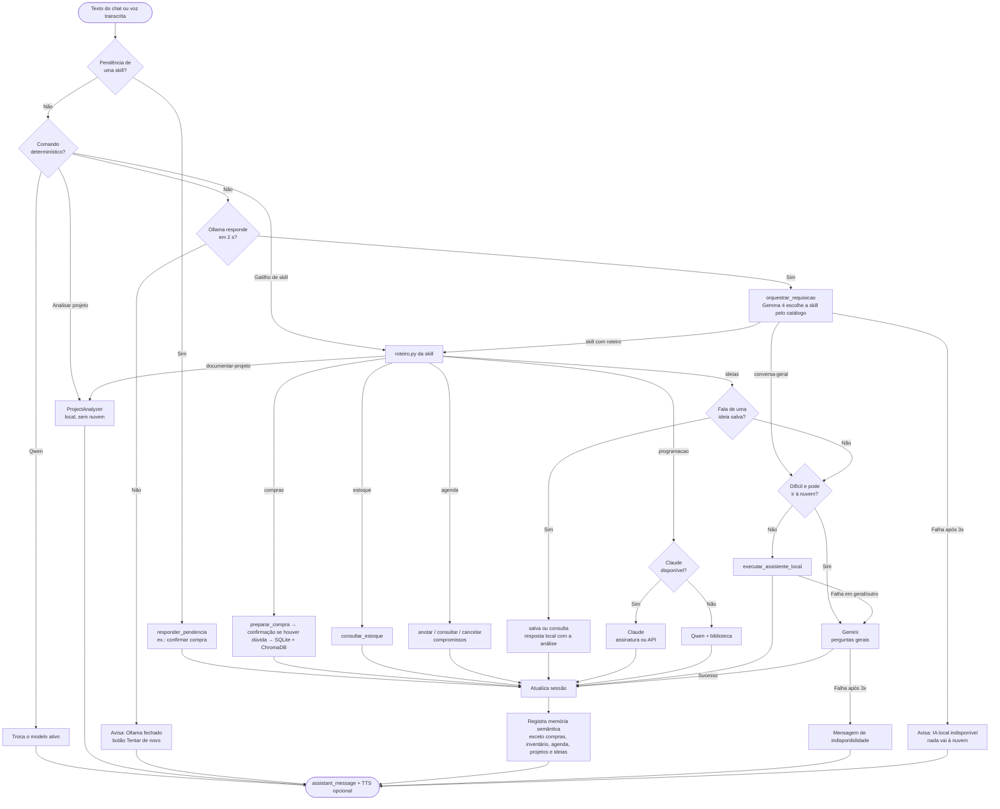
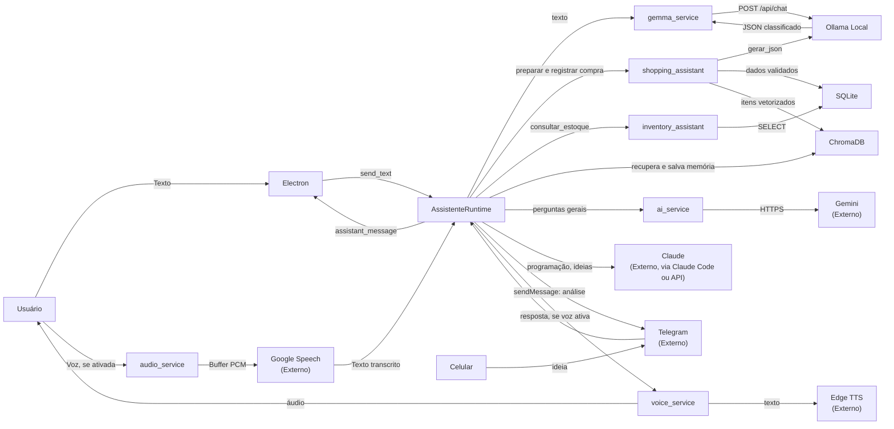
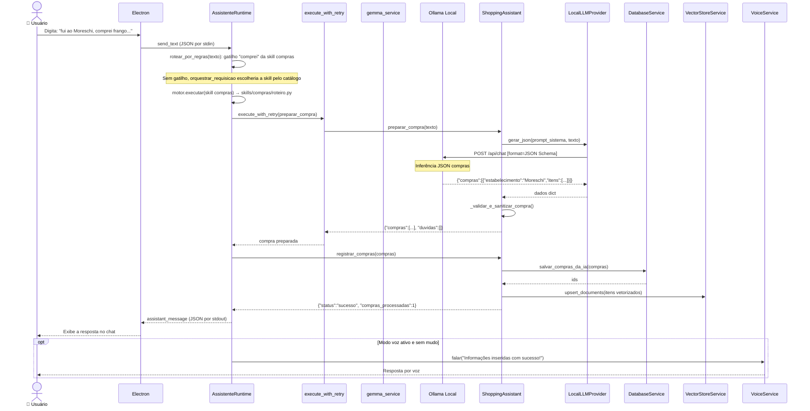
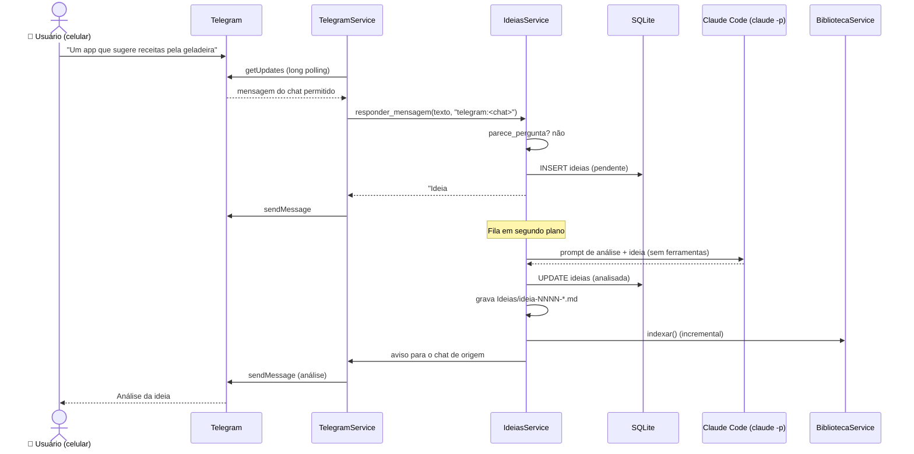
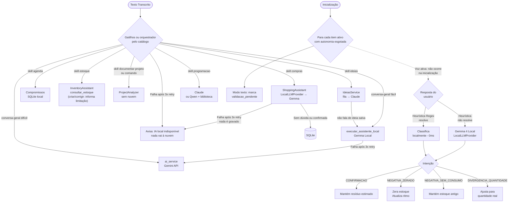

# 05 - Engenharia do Software

Este documento apresenta os diagramas técnicos de arquitetura, comunicação, fluxo e sequência do **Assistente Doméstico Inteligente**, no estado da **V4.1**.

> [!NOTE]
> Os diagramas abaixo foram revisados a partir do código-fonte da V4.1 em 23/11/2026 (branch `v4.1`, depois do commit `e9441bf`). Linhas tracejadas indicam código existente que não é acionado pelo fluxo atual.

---

## 1. Diagrama de Arquitetura — Componentes Principais

---

## 2. Diagrama de Fluxo — Processamento de uma Solicitação

Em paralelo, a **fila de ideias** manda as pendentes ao Claude e grava a análise. O **bot do Telegram** recebe ideias do celular e devolve a análise (seção 4.1).

---

## 3. Diagrama de Comunicação — Relações entre Componentes

---

## 4. Diagrama de Sequência — Execução Típica (Registro de Compra)

---

## 4.1. Diagrama de Sequência — Ideia pelo Telegram (V4.1)

---

## 5. Diagrama de Bifurcações — Pontos de Decisão do Sistema

---

## 6. Padrões de Engenharia Identificados no Código

| Padrão | Onde é aplicado | Finalidade |
|--------|-----------------|------------|
| **Strategy Pattern** | `llm_provider.py` (`BaseLLMProvider`) | Permite trocar o provedor LLM (local/nuvem) sem alterar os assistentes |
| **Dependency Injection** | `app/main.py` → `ShoppingAssistant`, `InventoryAssistant` | Provedores LLM são injetados externamente, facilitando testes e troca |
| **Retry Pattern** | `resilience_service.execute_with_retry` | Resiliência uniforme a falhas em qualquer chamada de LLM |
| **Fallback Chain** | `app/main.py`: Local → Gemini, só em `geral` e `outro` | Contingência sem enviar dados restritos à nuvem |
| **Chain of Responsibility** | Pipeline do runtime (pendência → comandos → gatilhos → orquestrador) e `InventoryAssistant`: regras → LLM | Processamento progressivo, do mais rápido para o mais custoso |
| **Session Management** | `GerenciadorDeSessao` em `app/main.py` | Manutenção de contexto e histórico entre interações |
| **Schema Validation** | `gemma_service._validar_schema_orquestrador` | Contrato rígido de saída do LLM orquestrador |
| **Sanitization Pipeline** | `llm_provider._sanitizar_resposta_json` | Remove marcações Markdown residuais do LLM antes do parse |
| **Event Loop com Fila** | `AssistenteRuntime.rodar` | Processa comandos do chat, voz e controles em uma única sequência |
| **Bridge Seguro** | `preload.js` (`contextBridge`) | Expõe ao renderer apenas a API necessária |
| **Inicialização Lazy** | `VoiceService`, `AudioService` | Só acessa o hardware quando o modo voz é ativado |
| **Singleton** | `EmbeddingService`, `VectorStoreService` | Evita recarregar o modelo e reabrir o cliente ChromaDB |
| **Fachada** | `ProjectAnalyzer` | Coordena varredura, extração, LLM local e documentação |
| **Índice Incremental** | `index_cache.py` | Reanalisa apenas arquivos com hash alterado |
| **Fail Fast** (V4.1) | `llm_provider.garantir_ollama_disponivel` | Verificação de saúde de 2 s; erro de conexão não entra na repetição |
| **Saída Estruturada** (V4.1) | `services/esquemas.py` | O contrato do orquestrador e da extração vai ao modelo, não só à validação |
| **Identificador de Correlação** (V4.1) | `logger_service.requisicao()` | Todos os eventos de uma solicitação levam o mesmo `req`, com o tempo de cada etapa |
| **Escrita Atômica por Renomeação** (V4.1) | `BackupService.fazer_backup` | A cópia é montada em `.parcial` e só recebe o nome final quando termina |
| **Retenção Avô-Pai-Filho** (V4.1) | `BackupService.aplicar_retencao` | 7 cópias diárias e a mais nova de cada uma de 4 semanas |
| **Plugin por Catálogo** (V4.1) | `core/skills/catalogo.py` + `skills/*/SKILL.md` | Uma capacidade nova é uma pasta; gatilhos e contextos vêm do cabeçalho |
| **Política no Cabeçalho** (V4.1) | `privacidade` das skills + `CLAUDE_SKILLS` em `_contexto_skill` | O núcleo só entrega o Claude (ou a nuvem) às skills autorizadas; testes conferem cabeçalho × política |
| **Contexto Mínimo** (V4.1) | `core.skills.Contexto` | O roteiro recebe só os serviços de que precisa, sem acesso ao runtime |
| **Encaminhamento** (V4.1) | `Resposta.encaminhar` | Um roteiro devolve o pedido à conversa geral quando não é com ele (P23) |
| **Adapter** (V4.1) | `ClaudeService` / `ClaudeAssinaturaService` | Mesma interface para API e assinatura; as skills não sabem qual está em uso |
| **Fila com Reteste** (V4.1) | `IdeiasService.iniciar_em_segundo_plano` | Ideia salva na hora; análise tentada de novo enquanto o Claude estiver indisponível |
| **Circuit Breaker Simples** (V4.1) | `indisponivel_ate` no estado do Claude | Sem cota ou sem login, não insiste até o horário de reteste |
| **Lista de Permissões** (V4.1) | `TELEGRAM_CHAT_IDS` | O bot ignora qualquer chat fora da lista |

