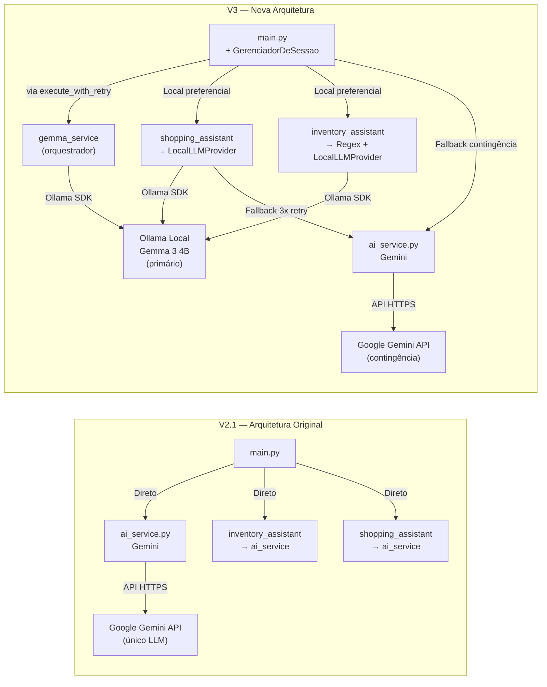

# 06 - Evolução da V2.1 para a V3

Este documento registra o histórico comparativo entre a **Versão 2.1 (V2.1 - Patch de Correção 1)** e a **Versão 3 (V3)** do **Assistente Doméstico Inteligente**, documentando as mudanças arquiteturais, novos componentes, alterações de responsabilidade e impactos técnicos e de experiência desta evolução.

---

## 1. Contexto da Evolução

A V2.1 era um sistema **100% dependente de APIs externas** para todas as funções de inteligência artificial. O Gemini da Google era o único motor de IA do sistema, responsável tanto pela estruturação de compras quanto pela classificação de intenções de inventário. Isso tornava o sistema:

*   **Suscetível a latência de rede** em todas as operações de IA.
*   **Custo-dependente** de uma API proprietária para cada interação.
*   **Quebrado em caso de indisponibilidade** do Gemini (mesmo com o retry do erro 503).
*   **Limitado** a operações que a API remota conseguia responder dentro da janela de timeout.

A **V3 muda o paradigma** ao introduzir um **LLM local** (Gemma 4 e:4b via Ollama) como camada **primária** de processamento, reduzindo o papel do Gemini para **fallback de contingência**. Isso representa a maior mudança arquitetural do sistema desde a V1.

---

## 2. Tabela Comparativa de Componentes

| Componente / Módulo | Situação na V2.1 | Situação na V3 | Tipo da Alteração |
| :--- | :--- | :--- | :--- |
| **Orquestrador (`main.py`)** | Fluxo linear. Chamava `ai_service.py` diretamente. Retry inline para erro 503 com `time.sleep(5)`. | Gerencia `GerenciadorDeSessao`. Chama `gemma_service.orquestrar_requisicao()` via `execute_with_retry`. Roteia fluxo com base na decisão do orquestrador local. | **Refatoração Significativa** |
| **Serviço de IA (`ai_service.py`)** | Fonte primária de toda IA do sistema. Chamado para compras e classificação de intenções. | Rebaixado a **fallback de contingência**. É chamado apenas quando o LLM local falha persistentemente ou quando `dificuldade="medio_dificil"`. | **Mudança de Papel** |
| **Assistente de Compras (`shopping_assistant.py`)** | Chamava `ai_service` diretamente. Dependente do Gemini para toda extração de JSON. | Agora utiliza `self.llm_provider.gerar_json()` (injetado). Por padrão recebe `LocalLLMProvider` e processa via Gemma 4 local. | **Refatoração + Novo Provider** |
| **Assistente de Inventário (`inventory_assistant.py`)** | Chamava `ai_service` diretamente para classificar as 4 intenções conversacionais. | Implementa dois níveis: (1) `_heuristica_rapida()` via Regex (~0ms), (2) `self.llm_provider.gerar_json()` com Gemma 4 local. Aceita `llm_provider` injetado. | **Refatoração + Heurística Adicionada** |
| **Serviço Gemma (`gemma_service.py`)** | **Inexistente.** | **Novo módulo** dedicado à orquestração local. Encapsula chamadas ao Ollama para classificação de contexto/dificuldade/ação. Valida schema e sanitiza resposta. | **Novo** |
| **Camada de Abstração LLM (`llm_provider.py`)** | **Inexistente.** | **Novo módulo** com interface `BaseLLMProvider` e implementações `LocalLLMProvider` (Ollama) e `CloudLLMProvider` (Gemini). Permite troca transparente de provedor. | **Novo** |
| **Serviço de Resiliência (`resilience_service.py`)** | **Inexistente.** O retry era um loop `while` inline no `main.py`. | **Novo módulo** com `execute_with_retry()` parametrizável. Centraliza toda lógica de retry, validação de retorno e alerta de voz em reprocessamento. | **Novo** |
| **Serviço de Voz (`voice_service.py`)** | Sem alteração de responsabilidade. | Sem alteração de responsabilidade. | **Mantido** |
| **Serviço de Áudio (`audio_service.py`)** | Sem alteração de responsabilidade. | Sem alteração de responsabilidade. | **Mantido** |
| **Banco de Dados (`db_service.py`)** | Sem controle de versão de schema. | Adicionado suporte a migrações via `PRAGMA user_version`. Migração v1 garante coluna `categoria` na tabela `controle_consumo`. | **Melhoria** |
| **Serviço de Log (`logger_service.py`)** | Funcional e completo desde a V2.1. | Sem alteração de responsabilidade. | **Mantido** |
| **Configuração (`core/config.py`)** | Sem alteração de relevância. | `RECORD_SECONDS` aumentado de 7 para 20 segundos (padrão). Sem outras alterações. | **Ajuste de Parâmetro** |

---

## 3. Novos Módulos em Detalhe

### 3.1. `services/gemma_service.py`

Este módulo é o ponto de entrada das chamadas ao LLM local para orquestração. Suas responsabilidades são:

*   Construir o `system_prompt` do orquestrador com todas as regras de classificação de dificuldade, contexto e ação.
*   Chamar o Ollama via `ollama.Client(timeout=120.0).chat()` com `format="json"` e temperatura 0.1 (alta determinismo).
*   Sanitizar o JSON bruto retornado (remoção de marcações Markdown `` ```json ``` ``).
*   Validar o schema do dicionário retornado, garantindo a presença e valores válidos dos campos `dificuldade`, `mudanca_de_contexto`, `contexto` e `acao`.
*   Lançar `InvalidOrchestratorOutputException` em caso de schema inválido (permite que o `resilience_service` faça retry).
*   Expor `executar_assistente_local()` para fluxos não-compras que ainda são roteados para o modelo local.

### 3.2. `services/llm_provider.py`

Implementa o **Strategy Pattern** para provedores de LLM:

*   `BaseLLMProvider` (abstrata): define os contratos `gerar_texto(prompt)` e `gerar_json(prompt_sistema, mensagem_usuario)`.
*   `LocalLLMProvider`: realiza chamadas ao Ollama com `ollama.Client(timeout=120.0)`, parseia o JSON e faz sanitização antes do parse.
*   `CloudLLMProvider`: delega para `ai_service.processar_requisicao_complexa()` como contingência de nuvem.

A injeção de dependências garante que `ShoppingAssistant` e `InventoryAssistant` recebam o provedor adequado sem conhecer sua implementação.

### 3.3. `services/resilience_service.py`

Substitui o loop `while` inline da V2.1 por uma solução centralizada e reutilizável:

*   **Parâmetros:** `funcao`, `args`, `max_tentativas`, `delay_segundos`, `excecoes_recuperaveis`, `callback_validacao`, `voz_reprocessamento`.
*   **Exceções estruturadas:** `MaxRetriesExceededException`, `InvalidOrchestratorOutputException`, `LLMConnectionException`.
*   **Comportamento:** A cada tentativa malsucedida, verifica se a exceção é recuperável, aguarda o delay e opcionalmente fala ao usuário "Reprocessando...". Ao esgotar as tentativas, lança `MaxRetriesExceededException`.
*   **Vantagem:** Um único ponto de manutenção para toda a lógica de resiliência do sistema.

---

## 4. Mudanças de Comportamento Notáveis

### A. Orquestração por LLM Local em vez do Gemini

Na V2.1, quando o usuário falava um comando, o `main.py` chamava `ai_service.py` diretamente com um prompt que tanto interpretava quanto estruturava a compra. Na V3, há uma **bifurcação explícita de responsabilidades**:

1. O **Gemma local** analisa o texto transcrito e decide **o que fazer** (qual assistente acionar, com qual prioridade).
2. O **assistente especializado** (ex: `ShoppingAssistant`) executa **o como fazer** (extrai dados, estrutura JSON, persiste).

Isso separa a orquestração da execução, alinhando-se ao princípio de responsabilidade única.

### B. Heurística Rápida Antes do LLM

No `InventoryAssistant`, antes de qualquer chamada ao LLM (seja local ou nuvem), o sistema tenta resolver a intenção do usuário via **Regex e correspondência de padrões** (`_heuristica_rapida()`). Isso cobre casos simples como "sim", "acabou", "não usei", "dois pacotes" em **zero milissegundos** de latência. Somente quando a heurística falha é que o Gemma local é consultado.

### C. Timeout de LLM Ajustado para Hardware Real

O `ollama.Client(timeout=120.0)` foi configurado para tolerar até **120 segundos** de tempo de inferência, pois testes reais mostraram que o Gemma 4 e:4b pode levar até **40 segundos** para processar um prompt longo em hardware sem GPU dedicada (CPU-only). Isso representa um ajuste crítico de infraestrutura que substituiu o antigo timeout padrão de 5 segundos.

### D. Controle de Versão de Schema do Banco

O `db_service.py` passou a utilizar `PRAGMA user_version` para controlar versões do schema. A migração `v1` garante que a coluna `categoria` exista na tabela `controle_consumo`, mesmo em instâncias antigas. Isso estabelece o padrão de migração incremental para evoluções futuras.

---

## 5. Diagrama de Evolução Arquitetural



---

## 6. Resumo Executivo da V3

### A. Mudança Principal
A V3 introduz o **Gemma 4 e:4b** (via Ollama) como **LLM local primário** do sistema, tornando o Gemini um fallback de contingência. Isso é a maior mudança arquitetural desde a criação do sistema.

### B. Novos Padrões Arquiteturais
*   **Strategy Pattern** para abstração de provedores LLM.
*   **Dependency Injection** para desacoplamento entre assistentes e provedores.
*   **Retry Pattern centralizado** via `resilience_service`.
*   **Chain of Responsibility** (Regex → LLM local) no `InventoryAssistant`.

### C. Impacto para o Usuário
*   O sistema não depende mais exclusivamente de internet para processar comandos de compra e inventário.
*   Reprocessamentos passam a ser comunicados ao usuário por voz de forma uniforme.
*   O tempo de resposta pode ser maior em hardware sem GPU (inferência local ~40s), mas é previsível e configurável.

### D. Impacto para Manutenção
*   A criação de `llm_provider.py` permite adicionar novos provedores de LLM sem alterar os assistentes.
*   O `resilience_service.py` centraliza toda a lógica de retry, facilitando ajustes de parâmetros sem tocar nos módulos de negócio.
*   O controle de versão do banco via `PRAGMA user_version` estabelece o padrão de migrações seguras.

### E. Dívidas Técnicas Identificadas
*   `ai_service.processar_requisicao_complexa()` faz referência a `self.gemini_client`, que não foi instanciado no `__init__`. O fallback de nuvem para o fluxo complexo está **inoperante** nesta versão.
*   O método `classificar_intencao_usuario()` em `ai_service.py` ainda utiliza o padrão de classificação da V2.1 (com 4 intenções da V2), coexistindo com o novo sistema de orquestração baseado em `dificuldade/contexto/acao`. Há duplicidade de responsabilidades não resolvida.
