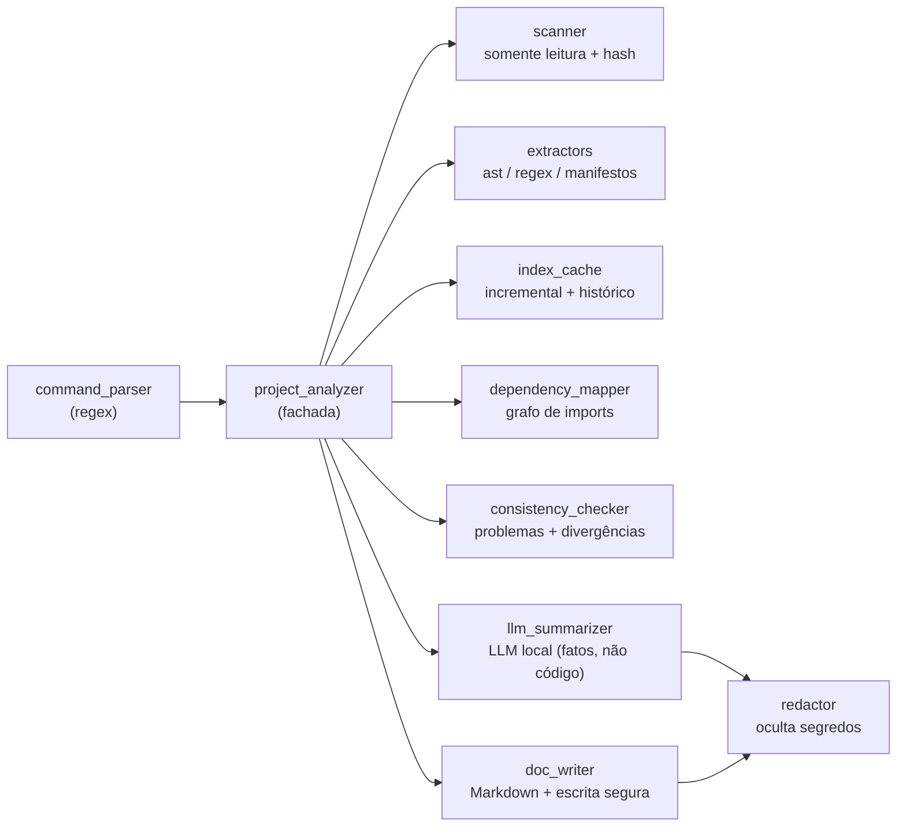

# 07 - Skill ProjectAnalyzer (Analista de Projetos e Documentação Técnica)

Skill que analisa projetos de software e gera documentação técnica em Markdown **100% local**: o Python faz a leitura, extração, indexação e escrita; o LLM local (Ollama, `qwen2.5-coder:7b`) apenas interpreta e redige a partir dos fatos extraídos. Nenhum dado é enviado ao Gemini ou a outro serviço externo.

**Versão:** 1.0.0 · **Pacote:** `services/project_analyzer/` · **Dependências novas:** nenhuma (biblioteca padrão do Python)

---

## 1. Como usar

**Pelo chat do Electron** (texto; caminhos não funcionam bem por voz):

```text
analisar projeto E:\MOBA
analise o projeto "E:\Agente IA\assistente-domestico"
documentar o projeto E:\MOBA
gerar documentação do projeto E:\MOBA
```

Sem caminho (`analisar projeto`), o assistente pede a pasta. O chat fica em `PROCESSING` até o fim da análise (decisão do usuário: execução síncrona); o andamento aparece no terminal de debug.

**Pela linha de comando** (sem Electron):

```text
python scripts/analyze_project.py "E:\MOBA"
python scripts/analyze_project.py "E:\MOBA" --sem-llm
python scripts/analyze_project.py "E:\MOBA" --modelo gemma4:e4b --saida "D:\Docs"
```

**Pré-requisito para a interpretação:** `ollama pull qwen2.5-coder:7b`. Sem o modelo, a documentação é gerada apenas com os dados determinísticos (seções interpretativas ficam como `NÃO IDENTIFICADO`).

## 2. Configuração (`core/config.py` / `.env`)

| Variável | Padrão | Uso |
|---|---|---|
| `PROJECT_ANALYZER_OUTPUT_DIR` | `E:\Agente IA\Documentacao_Gerada` (pasta-pai do repositório) | Única pasta onde a Skill escreve; uma subpasta por projeto |
| `PROJECT_ANALYZER_MODEL` | `qwen2.5-coder:7b` | Modelo local usado na interpretação |

## 3. Integração com o assistente

| Ponto | Alteração | Justificativa |
|---|---|---|
| `services/gemma_service.py` | `orquestrar_requisicao` detecta o comando por expressão regular **antes** de chamar a LLM e devolve `contexto="projetos"` com `parametros.caminho`; `projetos` incluído em `VALORES_PERMITIDOS` | Mesmo padrão dos comandos "ativar qwen"; não depende do Gemma acertar a classificação nem gasta inferência |
| `app/main.py` | Cria `ProjectAnalyzer` na Fase 1; interceptação `contexto == "projetos"` antes do roteamento | A rota termina ali: **sem** `execute_with_retry` com fallback para Gemini, **sem** RAG e **sem** gravação na memória semântica |
| `app/main.py` | `_preparar_vram_analise` / `_liberar_vram_analise` | Reaproveitam `alternar_modelo_vram`: descarregam o Gemma antes de carregar o Qwen e liberam o Qwen ao final (se o modo Qwen não estiver ativo), evitando os dois modelos na VRAM |
| `core/config.py` | Duas configurações novas | Pasta de saída e modelo definidos em um único lugar |

## 4. Arquitetura interna



| Módulo | Processamento | Responsabilidade |
|---|---|---|
| `scanner.py` | Python | Percorre o projeto sem seguir links; ignora `.git`, `node_modules`, `venv`, `__pycache__`, `chroma_db`; não lê binários nem arquivos > 1 MB; calcula SHA-256 |
| `extractors.py` | Python | `ast` para Python (classes, métodos, funções, imports inclusive tardios, `__main__`, `CREATE TABLE`); regex para JS/TS/HTML (require/import, IPC, `spawn`, `contextBridge`); `requirements.txt`, `package.json`, referências em `.md` |
| `dependency_mapper.py` | Python | Grafo interno (quem depende de quem), bibliotecas externas (com mapeamento import→pip, ex.: `google.genai`→`google-genai`), pontos de entrada, componentes centrais, diagrama Mermaid |
| `consistency_checker.py` | Python | Sintaxe, dependência não declarada / sem uso, import interno inexistente, import exclusivo do Windows, código duplicado (hash do corpo), nomes duplicados, `.gitignore.txt`, possíveis segredos, arquivos grandes; comparação documentação × código |
| `index_cache.py` | Python | Reutiliza fatos e resumos de arquivos com hash inalterado; calcula arquivos e símbolos adicionados/removidos/modificados; mantém histórico |
| `redactor.py` | Python | Oculta tokens e chaves (GitHub, Google, OpenAI, AWS, JWT, chaves privadas e atribuições do tipo senha ou api_key) em prompts e documentos |
| `llm_summarizer.py` | LLM local | Resumo por arquivo e síntese da arquitetura a partir dos fatos; até 6.000 caracteres por chamada; resumos intermediários (map-reduce) em projetos grandes; após 2 falhas seguidas o LLM é abandonado |
| `doc_writer.py` | Python | Gera os documentos; bloqueia escrita fora da pasta de saída; atualiza por seções preservando anotações manuais |
| `project_analyzer.py` | — | Orquestra o fluxo e devolve o resumo para o chat |

## 5. Documentos gerados

Em `<pasta de saída>/<nome do projeto>/`:

| Arquivo | Conteúdo |
|---|---|
| `README.md` | Índice e legenda de classificação |
| `01-visao-geral.md` | Linguagens, tecnologias, pontos de entrada, componentes centrais, arquitetura (LLM) e limitações |
| `02-modulos.md` | Por arquivo: responsabilidade, classes, funções, depende de / usado por, integrações, IPC |
| `03-dependencias-e-integracoes.md` | Bibliotecas, integrações, tabelas SQL, canais IPC, URLs e diagrama Mermaid |
| `04-problemas-encontrados.md` | Achados por gravidade, com classificação e evidências |
| `05-divergencias-documentacao.md` | Arquivos citados nos `.md` que não existem; código não citado em nenhum documento |
| `06-historico-de-alteracoes.md` | Evolução entre análises (arquivos e símbolos) |
| `.indice/` | Índice incremental e histórico (JSON) |

**Classificação:** `CONFIRMADO` (extraído do código, com arquivo:linha) · `INFERIDO` (conclusão a partir de evidências; inclui **todo** texto do LLM) · `NÃO IDENTIFICADO`.

Os documentos podem receber anotações manuais fora dos blocos `<!-- PA:INICIO ... -->` / `<!-- PA:FIM ... -->`; elas são preservadas nas próximas análises. A documentação original do projeto analisado **não é alterada** — as divergências são registradas no documento 05.

## 6. Regras de segurança

- Somente leitura no projeto analisado (abertura de arquivos apenas em modo `rb`); nenhum comando é executado; nada é instalado.
- Escrita restrita à pasta de saída (`EscritorSeguro` lança `EscritaNaoPermitidaError` para qualquer outro caminho). Se a pasta de saída estiver dentro do projeto, ela é excluída da varredura.
- O pacote não importa bibliotecas de rede, SDKs de nuvem, `subprocess` ou `shutil` (verificado por teste). O único LLM é o provedor local injetado pelo runtime.
- Valores de segredos nunca são enviados ao LLM nem escritos na documentação; apenas a contagem e o arquivo são informados.

## 7. Limitações conhecidas

- JavaScript, TypeScript e HTML são analisados por expressões regulares (parcial).
- A comparação documentação × código verifica referências a arquivos, não descrições de comportamento.
- Comportamento em tempo de execução (dados no banco, valores de configuração, chamadas dinâmicas) não é avaliado.
- O limite de contexto do Ollama não é configurado pelo `LocalLLMProvider` (`num_ctx` ausente); por isso cada chamada é limitada a ~6.000 caracteres.
- O teste com o Ollama real deve ser executado na máquina do usuário (ver seção 8).

## 8. Testes

```text
python -m unittest discover -s tests -v
```

22 testes com LLM simulado: extração, comando, escrita segura, preservação de anotações, projeto pequeno, projeto real (o próprio assistente, verificando que nenhum arquivo muda), projeto com 500 arquivos, segredos, incremental, LLM indisponível, ganchos de VRAM e ausência de dependências externas.

Teste com o modelo local real:

```text
ollama pull qwen2.5-coder:7b
python scripts/analyze_project.py "E:\Agente IA\assistente-domestico"
```

## 9. Manutenção

- Nova integração detectável: acrescentar o import em `INTEGRACOES_POR_IMPORT` (`extractors.py`).
- Import com nome diferente do pacote pip: `IMPORT_PARA_PIP` (`dependency_mapper.py`).
- Nova verificação: função em `consistency_checker.verificar_projeto` retornando `_achado(...)`.
- Mudança de prompts: `llm_summarizer.py` (seguir a Regra de Ouro: imperativo, 1 exemplo, esquema tipado).
- Ao alterar a estrutura dos fatos, incrementar `VERSAO_INDICE` em `index_cache.py` para invalidar o cache.
