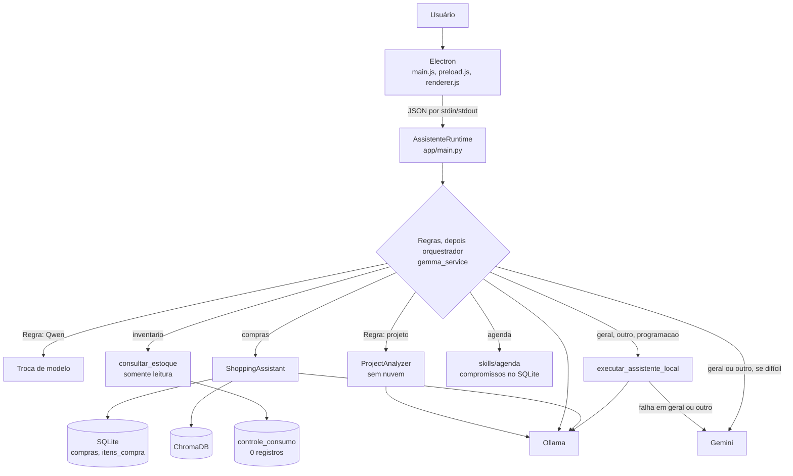

# 08 - Estado Atual da V4

Retrato técnico da **Versão 4 (V4)** do **Assistente Doméstico Inteligente** em **03/11/2026**, na branch `V4`, a partir do commit `c754a6a`, incluindo as correções da seção 6 e a Fase 1. Este documento registra o que funciona de fato, o que existe apenas no código e o que ainda não foi construído.

**Atualizações da V4.1:** seção 11 (17/11/2026), seção 12 (22/11/2026), seção 13 (23/11/2026, skills) e seção 14 (23/11/2026, encerramento da fase das skills). As seções 1, 2, 6 e 10 foram ajustadas ao estado de 23/11/2026; as demais mantêm o retrato de 03/11/2026. O histórico da versão está em `06 - Evolução da V4 para a V4.1.md`.

> [!IMPORTANT]
> Quando houver conflito entre este documento e descrições mais antigas, vale o que está aqui: ele foi escrito a partir do código e de testes executados. Havendo novas alterações de código, confira novamente.

**Legenda de evidência:** `TESTADO` (executado nesta análise) · `CÓDIGO` (confirmado pela leitura do código) · `DADOS` (confirmado no banco ou nos logs locais) · `NÃO TESTADO` (depende de hardware ou serviço indisponível na análise).

---

## 1. Resumo

A V4 é um assistente doméstico desktop: Electron na interface, Python no back-end, Ollama como IA local e Gemini como contingência na nuvem. A base está organizada e o back-end inicia e encerra corretamente, inclusive sem a chave do Gemini. O **registro de compras** e a **Skill ProjectAnalyzer** são os fluxos mais completos.

A Fase 1 concluiu a base confiável: frases conhecidas são roteadas por regras, compras têm validação e gravação segura, e somente perguntas gerais podem ir à nuvem. A V4.1 organizou o sistema em skills escolhidas por catálogo e acrescentou agenda, programação com o Claude e ideias de projetos recebidas pelo Telegram (seções 13 e 14). A gestão preditiva de estoque **ainda não funciona de ponta a ponta**, pois as compras gravadas não chegam à tabela de estoque (Fase 4).

| Indicador | Valor |
|---|---|
| Código versionado (Python, JS, HTML, CSS) | ≈ 15.600 linhas em 23/11/2026, com os testes (≈ 8.070 em 03/11) |
| Testes automatizados | 284 em 23/11/2026 (70 em 03/11); a fase das skills acrescentou os arquivos `test_skills`, `test_sk0`, `test_sk2`, `test_sk3`, `test_skp`, `test_sk6`, `test_sk7` e `test_ideias`; ver seções 11 a 14 |
| Testes de estoque, serviços vetoriais reais e IPC | Nenhum |
| Dados reais em `assistente_casa.db` (schema v2) | 4 compras, 11 itens, **0 em `controle_consumo`**; 3 ideias analisadas (23/11) |
| Problemas abertos | 7 (0 alto, 4 médios, 3 baixos); 16 resolvidos (P21 em 17/11; P13 e P22 em 22/11; P1, P9, P10, P16 e P23 em 23/11) |

---

## 2. Situação das funcionalidades

### Implementado e operante

| Funcionalidade | Observação | Evidência |
|---|---|---|
| Back-end com inicialização Text-First | Chega a `READY` e encerra com código 0 | `TESTADO` |
| Interface Electron com chat, modo voz, mudo e terminal de debug | Contrato IPC revisado; janela não aberta nesta análise | `CÓDIGO` |
| Registro de compras por LLM local, com gravação no SQLite e vetorização | Extração testada com o Gemma real; preço por embalagem e datas conferidos | `TESTADO` |
| Confirmação de compras em caso de dúvida e comando "desfazer última compra" | Desfazer vale para o último registro da sessão | `TESTADO` |
| Roteamento por regras, com o orquestrador apenas para casos ambíguos | 9 de 10 frases medidas foram roteadas sem IA, em menos de 0,1 s. Desde a V4.1, as regras são os gatilhos das skills, e o orquestrador escolhe pelo catálogo (44/48 em 0,87 s no PC) | `TESTADO` + `MEDIDO` |
| Política da nuvem | Só `geral` e `outro` vão ao Gemini, fora do Modo Qwen e sem histórico ou memórias restritos | `TESTADO` |
| Skill ProjectAnalyzer sem LLM | Analisou este projeto em 0,2 s | `TESTADO` |
| Memória semântica no ChromaDB e contexto RAG no assistente genérico e no Gemini | Funciona, com filtro permissivo (P19) | `CÓDIGO` + `DADOS` |
| Modo Qwen por comando de texto ou voz | Ativação, desativação e retorno por inatividade testados com troca de modelo simulada | `TESTADO` |
| Agenda (V4.1) | Anota, consulta e cancela compromissos; falta o aviso na hora e o Google Agenda (V7) | `TESTADO` |
| Consultas de gastos (M19) | Listar e somar compras, por categoria e por loja, preço de um produto e comparação de períodos; o período é lido por regra e o modelo só preenche o formulário | `TESTADO` (13 testes) e conferido numa cópia do banco real; acerto do formulário com o modelo real `NÃO TESTADO` (`medir-consultas.bat`) |
| Correção de compras (M10) | Valor, quantidade, nome do item, loja, data e remoção de item, com antes e depois e confirmação; estoque e total refeitos; correção registrada em `entradas` | `TESTADO` (8 testes) e numa cópia do banco real (renomear o item da moto); com o modelo real `NÃO TESTADO` |
| Histórico da conversa (M20) | Janela das últimas 6 trocas, resumo das antigas pelo modelo local, gravação em `historico_conversas` e retomada ao reabrir em até 12 h; "nova conversa" zera | `TESTADO` (6 testes) e migração v8 numa cópia do banco real; resumo com o modelo real `NÃO TESTADO` |
| Observações e ajustes | Observação na compra ou no item (acrescentar, trocar, apagar); ajustes somados antes do "sim"; aviso de compra repetida sem chave de acesso | `TESTADO` (7 testes) e migração v9 numa cópia do banco real |
| Programação com o Claude (V4.1) | Claude pela assinatura (`claude -p`) ou pela API; sem Claude, Qwen com biblioteca de contexto | `TESTADO` no PC (resposta em 5,5 s) |
| Ideias de projetos e bot do Telegram (V4.1) | Ideia salva na hora, análise do Claude em segundo plano, `.md` na biblioteca, resposta local sobre a ideia | `TESTADO` no PC (análise em cerca de 20 s) |
| Cópia de segurança diária e registro de eventos (V4.1) | M11 e M26 | `TESTADO` |

### Parcial

| Funcionalidade | O que falta | Problemas |
|---|---|---|
| Consulta de estoque por texto | Desde o M06 a tabela é preenchida pelas compras; compras gravadas antes do M06 não entram | — |
| Modo Qwen manual (`ativar qwen`) | Não libera a VRAM por completo e não executa ferramentas. A programação pela skill `programacao` (Claude ou Qwen) resolveu o P10 | P7 |
| Modo voz | Código presente; depende de microfone, Google Speech e Edge TTS | `NÃO TESTADO` |
| Bot do Telegram | Só guarda ideias; ainda não conversa com o assistente inteiro. Separa pergunta de ideia por regra simples | — |

### Existe no código, mas não está ligado ao fluxo

| Funcionalidade | Situação |
|---|---|
| Ajuste de estoque em nova compra (`processar_estoque_nova_compra`) | Nenhuma chamada no projeto |
| Baixa voluntária (`registrar_fim_estoque_direto`) | Nenhuma chamada no projeto |
| Perguntas de validação por voz | Inalcançáveis na prática (P8) |
| Busca híbrida SQLite + ChromaDB (`busca_hibrida_compra`) | Usada apenas em `scripts/validate_vector_database.py` (P12) |
| `CloudLLMProvider` | Criado em `app/main.py:162`, mas nunca entregue a um assistente |
| Tabela `historico_conversas` | Criada, nunca escrita nem lida |

### Planejado (`OBJETIVO DA VERSÃO.txt`), sem implementação

- Envio de arquivos de texto pelo chat. A interface tem apenas um campo de mensagem.
- Botão ou função "QWEN" no Electron.
- Troca de IA por intenção ("vou programar"). Hoje só frases exatas funcionam.
- Leitura de tela e pesquisa no Google (objetivo futuro).

---

## 3. Arquitetura em uso



| Modelo | Papel | Situação local |
|---|---|---|
| `gemma4:e4b` | Orquestrador e assistente padrão | Baixado; Ollama desligado na análise |
| `qwen2.5-coder:7b` | Modo Qwen e ProjectAnalyzer | Baixado; não executado na análise |
| `gemini-2.5-flash` | Perguntas gerais difíceis e contingência delas | Chamada real não executada |
| `paraphrase-multilingual-MiniLM-L12-v2` | Embeddings na CPU | Em cache; carregou com sucesso |

**Dados que saem da máquina (atualizado em 23/11/2026):** texto das ideias e pedidos de programação enviados ao Claude (assinatura ou API); mensagens ao bot do Telegram, quando ligado. Antes: perguntas gerais enviadas ao Gemini, com histórico e memórias apenas de `geral` e `outro`; e, no modo voz, áudio enviado ao Google Speech e texto enviado ao Edge TTS. Compras, estoque, agenda, programação e documentação não vão ao Gemini. Com o Ollama parado, frases sem regra também não vão, pois não há como saber se são privadas.

---

## 4. Ambiente e execução

| Item | Verificado em 03/11/2026 |
|---|---|
| Python / Node / Electron | 3.13.5 / 22.15.0 / 31.7.7 |
| Dependências Python principais | Instaladas |
| `GEMINI_API_KEY` | Definida no ambiente do sistema; **não existe `.env`** no projeto. A chave é opcional |
| Cópia do banco antes da Fase 1 | `core/database/backups/assistente_casa_pre_fase1_2026-11-03.db` |
| Ollama | Instalado, serviço parado |

```bash
ollama serve
```

```bash
npm start
```

Executar somente o back-end, sem interface:

```bash
python app/main.py
```

Executar os testes:

```bash
python -m unittest discover -s tests -v
```

**Git:** a branch `V4` está publicada no GitHub e é a branch padrão do repositório desde 16/11/2026. O `V3` remoto contém o commit `a8ad2ca`, que não faz parte da V4.

---

## 5. Validação executada

Os testes usam bancos temporários e LLM simulado. No banco real, foram feitas apenas a migração para o schema v2 e a remoção autorizada da compra nº 5, depois de uma cópia de segurança.

| Verificação | Resultado |
|---|---|
| `python -m unittest discover -s tests` | 70 de 70 aprovados |
| Início do back-end **sem** `GEMINI_API_KEY`, com pedidos de agenda e gastos | `system_ready`, respostas corretas e saída com código 0 |
| Teste real com Gemma (10 frases) | 9 por regras em menos de 0,1 s; "Vou programar agora" ficou local, em 22 s |
| Teste real de extração (4 compras) | Arroz gravaria R$ 27,90 (5 kg na embalagem); "ontem" resultou em 02/11/2026; mercado ausente gerou confirmação |
| `tests/test_gemma_service.py` antes das correções | Falhou nos casos de P2, P6 e P17, confirmando os defeitos |
| Compilação de `app`, `core`, `services` e `scripts` com `SyntaxWarning` como erro | Sem ocorrências |
| ProjectAnalyzer com Qwen real em `services/vector` | 7 chamadas em 81,5 s, cerca de 12 s por chamada |
| ProjectAnalyzer `--sem-llm` neste repositório | 70 arquivos, 5 achados, sem alterações no repositório |
| Reprodução de P1, P2, P4, P5, P6, P11 e P20 | Confirmados antes das correções (seção 6) |

**Não testado:** janela do Electron, chamada real ao Gemini, microfone, TTS e reconhecimento de voz. Amostras reais pequenas não garantem acerto em toda frase ou compra.

O achado de gravidade alta do ProjectAnalyzer é um **falso positivo**: trata-se do token fictício `TOKEN_FALSO`, usado no teste de ocultação de segredos.

---

## 6. Problemas conhecidos

### Gravidade alta

| ID | Problema | Local | Efeito | Evidência |
|---|---|---|---|---|
| P1 | **Compras não alimentam o estoque.** Não existe `INSERT` em `controle_consumo`, e o `ShoppingAssistant` não chama o `InventoryAssistant`. | `services/shopping_assistant.py:245` | Consulta sempre vazia; varredura sem itens; gestão preditiva inoperante | `TESTADO` + `DADOS` |

### Gravidade média

| ID | Problema | Local | Efeito | Evidência |
|---|---|---|---|---|
| P7 | Assistentes usam Gemma fixo mesmo no modo Qwen. | `app/main.py:170` | Os dois modelos podem ocupar a VRAM ao mesmo tempo | `CÓDIGO` |
| P8 | A varredura roda só no início, com o modo voz ainda desligado, e `validacao_pendente` nunca vira pergunta. | `app/main.py:691`, `services/inventory_assistant.py:307` | Validação por voz inalcançável | `CÓDIGO` |
| P12 | Vetores de compras em tempo real não têm `entity_id`, e a busca híbrida não está ligada ao fluxo. | `services/shopping_assistant.py:500` | Sem hidratação de valores exatos do SQLite | `CÓDIGO` |
| P14 | Migração e fluxo em tempo real usam IDs diferentes para o mesmo item. | `scripts/migrate_vector_database.py:58`, `services/shopping_assistant.py:491` | Itens duplicados no ChromaDB | `CÓDIGO` |

### Gravidade baixa

| ID | Problema | Local | Evidência |
|---|---|---|---|
| P18 | Erros aparecem apenas no terminal interno, não no chat. | `renderer.js:282` | `CÓDIGO` |
| P19 | Toda frase com 4 ou mais palavras vira memória de longo prazo. | `services/vector/memory_service.py:48` | `CÓDIGO` |
| P20 | Heurística confunde respostas: "sim, mas sobraram dois" e "assim que abri acabou" viram `CONFIRMACAO`. Efeito futuro, pois o fluxo está inativo. | `services/inventory_assistant.py:175` | `TESTADO` |

### Resolvidos em 23/11/2026

| ID | Problema | Correção | Validação |
|---|---|---|---|
| P1 | Compras não alimentavam o estoque | Cada item gravado soma ao estoque do produto do catálogo, na mesma transação (M06, com M07) | `tests/test_m06.py` (`TESTADO`); cópia do banco real conferida |
| P16 | Python ausente derrubava o Electron sem aviso | `main.js` trata o evento `error` do processo e mostra a orientação; Python configurável por `ASSISTENTE_PYTHON` ou `.venv` (M27) | `tests/test_m27.py` (`TESTADO`); janela real `NÃO TESTADO` |
| P10 | `programacao` (e `projetos`) não estavam entre as opções do orquestrador | O orquestrador escolhe entre todas as skills do catálogo (SK2) | `tests/test_sk2.py` (`TESTADO`) |
| P23 | Pedido de sugestões com a palavra "ideias" ia para a skill `ideias`; no Telegram, perguntas viravam ideias | A skill só consulta quando o pedido se refere a uma ideia salva e encaminha o resto à conversa geral (`Resposta.encaminhar`). No Telegram, perguntas e pedidos não são salvos; "ideia: ..." ou "/ideia ..." salvam sempre | `tests/test_ideias.py` (`TestP23`, `TestP23NoApp`) (`TESTADO`) |
| P9 | Agenda não persistia dados | Skill `agenda` com roteiro e tabela `compromissos` (SK7) | `tests/test_sk7.py` (`TESTADO`) |

### Resolvidos em 17/11/2026

| ID | Problema | Correção | Validação |
|---|---|---|---|
| P21 | Chat só ficava disponível depois da carga do modelo de embeddings (15 a 50 s nos logs) | Embeddings carregados em segundo plano: chat pronto em 3,5 s e memória em 13,0 s (seção 11) | `MEDIDO` |

### Resolvidos em 22/11/2026

| ID | Problema | Correção | Validação |
|---|---|---|---|
| P13 | `rebuild_embeddings.py` apagava a coleção inteira e só recriava dados vindos do SQLite: perda definitiva das memórias `mem_*` | Cópia de segurança, exportação das memórias para JSON, reindexação e regravação das memórias; nada é apagado se a leitura falhar | `tests/test_m11.py` (`TESTADO`) |
| P22 | `with get_connection()` confirmava, mas não fechava a conexão SQLite (`ResourceWarning` nos testes) | Conexão criada com `_ConexaoQueFecha`, que fecha ao sair do `with`, inclusive com erro | `tests/test_m11.py`; suíte sem `ResourceWarning` do SQLite (`TESTADO`) |

### Resolvidos em 03/11/2026

| ID | Problema | Correção | Validação |
|---|---|---|---|
| P2 | `desativar qwen` ativava o Qwen, pois o texto contém "ativar qwen" | Comandos de desativação são avaliados primeiro; `desativar modo qwen` foi incluído | `tests/test_gemma_service.py` |
| P6 | Inatividade de 30 minutos nunca desativava o Qwen, pois o horário era renovado antes da verificação | A verificação ocorre antes da renovação do horário | `tests/test_gemma_service.py` |
| P17 | Sequências de escape inválidas em `PROMPT_PROGRAMACAO`, incluindo `\a`, que virava caractere de controle | O prompt passou a ser string raw | `tests/test_gemma_service.py` |
| P3 | Gemini usava prompt fixo de compras, e falhas locais de compras podiam parecer registradas | Prompt geral; compras não vão à nuvem e a falha é informada | `tests/test_fase1.py` |
| P4 | Consultas de compras eram tratadas como registro | A rota respeita `acao`; consulta nunca grava | `tests/test_fase1.py` |
| P5 | Nova tentativa duplicava compras | Só a extração é repetida; a gravação ocorre uma vez, em transação única | `tests/test_fase1.py` |
| P11 | Sem chave do Gemini, o sistema não iniciava | Cliente criado no primeiro uso; sem chave, tudo fica local | `tests/test_fase1.py` e início real |
| P15 | Erros de cota não eram convertidos | A rota usa `chamar_llm` e não repete em cota esgotada | `tests/test_fase1.py` |

A verificação de inatividade ocorre na solicitação seguinte, não em segundo plano. Enquanto isso, o Ollama libera o modelo ocioso pelo próprio `keep_alive`.

---

## 7. Código sem uso e dívida técnica

- **Sem chamadas no projeto:** `parse_json_com_fallback`, `classificar_intencao_usuario`, `enviar_prompt_json`, `salvar_compra_da_ia`, `obter_itens_expirados_para_validacao`, `obter_dados_produto_por_nome`, `atualizar_recompra_e_ritmo`, `zerar_estoque_item`, `zerar_estoque_por_nome`, `pre_carregar_modelo` e os callbacks de áudio e voz.
- **Duplicado:** `_sanitizar_resposta_json` nos dois provedores de LLM (a cópia sem uso do `gemma_service.py` saiu no SK5).
- **M27 (23/11):** modelos, tempos e repetição foram para o `config.py`; o Electron não depende mais de `python` no PATH; bipes não dependem do Windows.
- **Configurações sem uso:** `SAMPLE_RATE`, `CHANNELS`, `CHUNK_SIZE`, `RECORD_SECONDS` e `GEMINI_API_KEY` em `core/config.py`.
- **Estado de interface sem origem:** o back-end nunca emite `RESPONDING`.
- **Cobertura:** roteamento, compras, política da nuvem e parte do runtime têm testes. Faltam estoque, serviços vetoriais reais, voz e IPC.

---

## 8. Objetivo da versão × entrega

| Item do `OBJETIVO DA VERSÃO.txt` | Situação |
|---|---|
| Electron com chat de texto | Entregue |
| Ligar e desligar microfone | Entregue (não testado com hardware) |
| Enviar arquivos de texto pelo chat | Não entregue |
| Segunda IA local (Qwen 2.5-Coder 7B) | Parcial |
| Trocar de IA por comando de texto ou voz | Entregue para frases exatas |
| Trocar de IA por função no Electron | Não entregue |
| Voltar ao Gemma ao pedir | Entregue para frases exatas |
| Voltar ao Gemma ao reiniciar | Entregue (estado apenas em memória) |
| Voltar ao Gemma após 30 min sem atividade | Entregue, com aplicação na solicitação seguinte |

---

## 9. Documentação do projeto

| Documento | Situação em 03/11/2026 |
|---|---|
| `01` a `05` nesta pasta | Atualizados para a V4 nesta revisão |
| `06 - Evolução da V3 para a V4.md` | Criado nesta revisão |
| `07 - Skill ProjectAnalyzer.md` | Correto |
| `README.md` | Reescrito para a V4 em 16/11/2026; selo de testes e contagem atualizados em 17/11/2026 |
| `CHANGELOG.md` | Atualizado com as correções de 03/11/2026; a lista completa de problemas está neste documento |

---

## 10. Próximos passos recomendados

Ordem aprovada em 03/11/2026:

1. **Fase 1, base confiável:** concluída.
2. **Fase 2, documentação:** pedidos naturais, leitura de `.md` e `.txt` e mais contexto para os modelos.
3. **Fase 3, consultas de compras:** gastos por mês, mercado e categoria, além de histórico de preços.
4. **Fase 4, estoque (P1):** catálogo de produtos, itens recorrentes, conversão de unidades e ritmo de consumo.
5. **Fase 5, lista e previsões:** lista de compras e comparação entre mercados.

Pendências paralelas: concluir o modo Qwen (P7, botão e troca por intenção), definir o envio de arquivos pelo chat, publicar a branch `V4` e atualizar `README.md`.

**Atualização de 23/11/2026:** a agenda, a programação com o Claude (P10) e o README foram resolvidos na V4.1. Próximos itens do roadmap do sistema, por impacto:
1. **M06:** compras alimentam o estoque (P1).
2. **M19:** consultas de gastos sem SQL livre (Fase 3).
3. **M07:** catálogo de produtos e categorias fechadas.
4. **M29/M30:** transcrição local e palavra de ativação.

Também está pendente o envio dos commits da `v4.1` ao GitHub e o PR para a `V4`.

---

## 11. Atualização V4.1 (17/11/2026)

Alterações feitas depois do retrato de 03/11/2026. As seções anteriores não foram reescritas; onde houver conflito, vale esta.

| Item | O que mudou | Evidência |
|---|---|---|
| Integração contínua | Fluxo `Testes` no GitHub Actions: sintaxe Python e JavaScript, suíte completa e linter informativo | `CÓDIGO`; execução no GitHub `NÃO TESTADO` |
| Saída estruturada | Orquestrador e extração de compras enviam JSON Schema no `format` do Ollama; recaída para `format="json"` com biblioteca antiga; opção `OLLAMA_SAIDA_ESTRUTURADA` | `MEDIDO`: 100% de respostas válidas, acerto igual ao JSON simples |
| Início do sistema (P21) | Modelo de embeddings carregado em segundo plano; busca semântica ignorada durante a carga; memória gravada depois da resposta | `MEDIDO`: chat em 3,5 s, memória em 13,0 s |
| Leitura dos comandos do Electron | Pipe lido por descritor privado (`ENTRADA_IPC`); entrada padrão trocada por `os.devnull`. Sem isso, a carga dos embeddings travava até a mensagem seguinte | `MEDIDO`: antes não ficava pronta em 150 s |
| Embeddings | `EMBEDDING_DEVICE` (padrão `cpu`; antes ia para `cuda:0`) e carga só do cache local, sem as ≈ 30 consultas ao Hugging Face por início | `MEDIDO` |
| Orquestrador | Raciocínio (`think`) desligado no Gemma 4; opção `OLLAMA_RACIOCINIO` no `.env` | `MEDIDO`: 8,1 s → 1,2 s por decisão, 16/16 acertos |
| Ollama fechado (M17) | Verificação de saúde de 2 s antes de chamar o modelo; erro de conexão sem repetição; mensagem com botão "Tentar de novo"; aviso no início | `MEDIDO`: resposta em 2,38 s com o Ollama fechado (antes, no mínimo 6 s) |
| Banco vetorial | `upsert_documents` cancela a gravação quando não há embeddings | `TESTADO` |

**Validação:** `python -m unittest discover -s tests` com 105 de 105 aprovados em Python 3.10, com `ollama`, `python-dotenv` e `google-genai` substituídos por módulos simulados (os testes não chamam esses serviços). Compilação de `app`, `core`, `services`, `scripts` e `tests` com `SyntaxWarning` como erro, sem ocorrências. `node --check` nos três arquivos do Electron, sem erros.

**Comportamento a observar no uso real:**
- Uma compra registrada nos primeiros segundos após abrir o aplicativo aguarda o fim da carga dos embeddings antes de confirmar, pois a vetorização ocorre antes da resposta.
- A primeira extração de compras com esquema deve ser conferida com frases reais (as quatro do teste da seção 5). Se a qualidade cair, `OLLAMA_SAIDA_ESTRUTURADA=0` restaura o comportamento anterior.
- O esquema exige servidor Ollama e biblioteca `ollama` compatíveis com saída estruturada (`pip install -U ollama`).

### Medições no PC do usuário (17/11/2026)

Feitas com `scripts/medir_v41.py`; relatórios completos em `Planejamento/medicoes`.

| Orquestrador (16 chamadas, modo esquema) | Acertos | Mediana | Tokens gerados |
|---|---|---|---|
| Gemma 4 E4B com raciocínio (anterior) | 16/16 | 8,1 s | 448 |
| **Gemma 4 E4B sem raciocínio (adotado)** | **16/16** | **1,2 s** | 36 |
| Qwen 2.5 Coder 7B | 16/16 | 1,5 s | 42 |

- O Gemma 4 E4B continua como orquestrador: acerta o mesmo que o Qwen, responde mais rápido e ocupa menos VRAM.
- O gargalo era o raciocínio ligado por padrão no Ollama, não a capacidade do modelo: de 1.200 a 2.700 caracteres de raciocínio por decisão.
- A extração de compras ainda roda com o raciocínio no padrão (6/6 acertos, mediana de 10,8 s com esquema). Desligar depende de nova medição.
- Amostra pequena: 8 frases com 2 repetições cada. Um conjunto de avaliação maior (M13) segue recomendado.

## 12. Atualização V4.1 (22/11/2026)

| Item | O que mudou | Evidência |
|---|---|---|
| Cópia de segurança (M11) | Uma cópia por dia ao abrir o app (e a cada hora, se continuar aberto) em `core/database/backups/auto/AAAA-MM-DD/`: banco por `VACUUM INTO` com `integrity_check`, ChromaDB em `chroma_db.zip`, `manifesto.json` com SHA-256. Retenção de 7 diárias e 4 semanais. `scripts/fazer_backup.py` para cópia manual | `TESTADO` (18 testes); cópia dos dados reais em pasta temporária: 12 ms, contagens iguais à origem |
| Registro de eventos (M26) | `Logs/eventos-AAAA-MM-DD.jsonl`, uma linha JSON por evento, identificador por requisição e tempo por etapa; retenção de 30 dias; `LOG_CONTEUDO=0` omite o texto do usuário; `scripts/ver_logs.py` para leitura e resumo por etapa | `TESTADO` (13 testes e 1 de integração com o pipeline) |
| Reconstrução dos embeddings (P13) | Preserva as memórias `mem_*` | `TESTADO` |
| Conexões SQLite (P22) | Fechadas ao sair do `with` | `TESTADO` |

**Validação:** `python -m unittest discover -s tests` com 137 de 137 aprovados em Python 3.10, com `ollama`, `python-dotenv` e `google-genai` simulados. Compilação com `SyntaxWarning` como erro e `node --check` sem ocorrências.

**Restaurar uma cópia:** com o app fechado, copie `assistente_casa.db` da pasta do dia para `core/database/` e extraia `chroma_db.zip` em `core/database/chroma_db/` (pasta vazia). O `manifesto.json` traz o SHA-256 de cada arquivo para conferência.

**Observações:**
- Os arquivos `Logs/<módulo>/log.txt` deixaram de receber linhas; ficam como histórico até serem apagados manualmente.
- Alguns testes antigos (`test_gemma_service.py` e parte de `test_fase1.py`) não redirecionam os logs e escrevem no `Logs/` real ao rodar a suíte. Já acontecia com os arquivos `.txt`.
- O único `ResourceWarning` restante na suíte vem de `_isolar_entrada_ipc` (`app/main.py`), que deixa o `os.devnull` aberto de propósito durante toda a execução.

## 13. Skills: SK0 e SK1 (23/11/2026)

| Item | O que mudou | Evidência |
|---|---|---|
| Formato de skill (SK1) | `skills/<nome>/SKILL.md` com cabeçalho YAML e `prompts/*.md`; catálogo em `core/skills/` | `TESTADO` (13 testes) |
| Roteador por regras | Gatilhos lidos dos cabeçalhos das skills, em ordem de prioridade | `TESTADO`: 0 diferenças em 168 decisões de referência |
| Prompts | Programação, extração de compras e assistente geral fora do Python | `TESTADO`: mesmo texto |
| Medição (SK0) | `scripts/avaliar.py` com `evals/casos.jsonl` (48 frases) e `evals/compras.jsonl` (8 compras) | Ferramenta `TESTADO`; medição real `NÃO TESTADO` (requer o Ollama no PC) |

| Medição (SK0, PC do usuário) | Gemma no catálogo: 45/48 em 0,55 s; prompt por contextos: 43/48 em 1,39 s; Qwen Coder falha na chamada nativa; troca de modelo 13 a 15 s | `MEDIDO` (`Planejamento/medicoes/sk0-20261123-0825.md`) |
| Orquestrador (SK2) | Escolhe a skill pelo catálogo, com prompt fixo; resolve o P10 (o prompt por contextos foi removido no SK5) | `TESTADO` (10 testes) e `MEDIDO` no PC: 44/48 em 0,87 s (antes 43/48 em 1,39 s) |
| Privacidade | Pesquisa de preço entre mercados passa por gatilho de `compras` (antes podia cair na conversa geral) | `TESTADO` |

| Roteiros (SK3) | Compras, estoque e agenda executam `skills/<nome>/roteiro.py`; confirmação de compra virou pendência genérica de qualquer skill | `TESTADO` (7 testes) |

| Programação (SKP) | Claude (API) como principal; sem cota, Qwen local; reteste na primeira solicitação depois das 8h; limite mensal de gasto; biblioteca de contexto no ChromaDB | `TESTADO` (18 testes); chamada real `NÃO TESTADO` |

| Limpeza (SK5) | Orquestrador antigo removido; documentação de projeto com roteiro; contextos válidos vindos do catálogo; `main.py` dividido em `ipc`, `sessao` e `voz` | `TESTADO` (191 testes) e teste de fumaça do processo real |

| Fábrica de skills (SK6) | `scripts/nova_skill.py` a partir de `skills/_modelo`; `scripts/validar_skills.py` na integração contínua; `llm_local` para toda skill | `TESTADO` (7 testes) |

| Agenda (SK7) | Anotar, consultar e cancelar compromissos, feita só em `skills/agenda/`; resolve o P9 | `TESTADO` (8 testes); no PC com o modelo real `NÃO TESTADO` |

| Ideias (23/11) | Skill `ideias`, fila de análise pelo Claude, `.md` na biblioteca local, Claude pela assinatura (`claude -p`) e bot do Telegram | `TESTADO` (21 testes) e `TESTADO` no PC em 23/11: ideias #9 a #11 enviadas pelo Telegram, analisadas pelo Claude pela assinatura em cerca de 20 s, `.md` gravado e análise devolvida ao chat |

**O que ainda não muda:** a conversa geral continua no `app/main.py`, porque a política de nuvem (Gemini) é do núcleo.

**Validação:** 226 de 226 testes aprovados, nas mesmas condições da seção 12.

## 14. Encerramento da fase das skills (23/11/2026)

| Item | Situação | Evidência |
|---|---|---|
| Etapas SK0 a SK3, SK5 a SK8 e SKP | Concluídas; SK4 ficou de fora por decisão | `Planejamento/09-roadmap-skills.md` |
| Claude pela assinatura | `CLAUDE_MODO=assinatura` (padrão), Claude Code instalado e logado no plano; resposta curta em 5,5 s | `TESTADO` no PC (`testar-claude-assinatura.bat`) |
| Ideias pelo Telegram | Três ideias recebidas, analisadas em cerca de 20 s cada e devolvidas ao chat; `.md` gravados em `Ideias/` | `TESTADO` no PC |
| P23 | Pedido de sugestões encaminhado à conversa geral; perguntas no Telegram não viram ideia | `TESTADO` (4 testes) |
| Suíte | 238 de 238 testes aprovados (231 ao fechar a fase; +7 do M27) (ambiente com bibliotecas externas simuladas) | `TESTADO` |

**Dados que saem da máquina, em resumo:** perguntas gerais (Gemini, se configurado), texto das ideias e pedidos de programação (Claude), mensagens ao bot (Telegram) e, no modo voz, áudio (Google Speech) e texto (Edge TTS). Compras, estoque e agenda não saem.

**Pendente:** testar com o modelo real a escolha das 4 frases novas de `evals/casos.jsonl` (r50, r52 e r53 dependem do modelo); enviar os commits ao GitHub.

## 15. V4.2 — medir antes de mudar (23/11/2026)

| Item | O que mudou | Evidência |
|---|---|---|
| M09 Origem dos registros | Tabela `entradas` (migração v3): texto, canal, resposta do modelo, modelo, versão do prompt e duração de cada pedido de compra, ligada à compra; descartadas e desfeitas ficam registradas | `TESTADO` (8 testes); migração no banco real na próxima abertura (só acrescenta) |
| M13 Conjunto de avaliação | Histórico das medições (`historico-avaliacao.jsonl`), acerto da extração por campo e versão dos prompts em cada relatório | `TESTADO`; histórico com as medições de 23/11 |
| M15 Prompt enxuto | Feito pelo SK2 e reduzido de novo pelo M16 | `MEDIDO` (SK0: 1.624 → 325 tokens) |
| M16 Nuvem por escolha | Gemini só quando pedido ou na falha local; sem `dificuldade` no orquestrador | `TESTADO` e `MEDIDO` no PC (23/11 19:48): escolha 50/53 (antes 44/48), p50 0,75 s e p95 0,83 s (antes 0,87 e 1,01), 16 tokens gerados (antes 27) |
| M14 Classificador por similaridade | Descartado: o catálogo já atinge a meta (p95 de 0,83 s na medição mais recente) | `MEDIDO` (histórico) |

**Observado no histórico:** a extração de compras chega a p95 de 23,8 s (Gemma, sem raciocínio, 8 casos). Vale investigar na V4.3.

## 16. V4.3, parte 1 — catálogo, centavos e estoque (23/11/2026)

| Item | O que mudou | Evidência |
|---|---|---|
| M07 Catálogo e categorias | 15 categorias fechadas (esquema e prompt); tabela `produtos` com nome normalizado; produto novo cadastrado sozinho; itens antigos migrados com categoria pelo nome | `TESTADO` (7 testes); cópia do banco real: 11 itens em 10 produtos, categorias conferidas |
| M08 Centavos | Colunas `*_centavos` preenchidas na entrada e na migração; totais somados em centavos | `TESTADO` (4 testes); cópia do banco real: totais iguais à soma dos itens |
| M06 Estoque pelas compras | Item gravado soma ao estoque em unidade base; ritmo aprendido na recompra; desfazer tira do estoque; consulta com unidade | `TESTADO` (10 testes, inclusive o critério "comprei 2 litros de leite" → "ainda tenho leite?"); migração no banco real na próxima abertura |

**Migrações v3 a v6 no banco real:** acontecem na próxima abertura do assistente, depois da cópia de segurança do dia. Só acrescentam tabelas e colunas e preenchem as novas; nada é apagado.

## 17. Notas fiscais por arquivo (23/11/2026)

| Item | O que mudou | Evidência |
|---|---|---|
| NFC-e em HTML | Leitor exato da página da Sefaz; desconto distribuído; embalagem pelo nome; dados do consumidor ignorados | `TESTADO` com uma nota real (Muffato, 13/11/2026; CPF trocado por fictício no arquivo de teste) |
| PDF | Texto extraído com `pypdf` e enviado à extração por texto; PDF digitalizado deve ir como foto | `TESTADO` (PDF gerado no teste); `pypdf` precisa ser instalado no PC |
| Foto | Modelo local de visão lê o cupom; sempre com revisão | `TESTADO` com modelo simulado; leitura real no PC `NÃO TESTADO` |
| Pasta de entrada | `Entradas/` vigiada; resumo com "sim/não"; arquivo movido para `processados/` ou `com_erro/` | `TESTADO` |
| Telegram | Arquivo ou foto vai para a pasta de entrada; resumo também no celular | `TESTADO` com Telegram simulado |
| Duplicidade | Chave de acesso registrada (migração v7); a mesma nota não entra duas vezes | `TESTADO` |

**Dados:** o arquivo original (que traz o CPF impresso na nota) fica só no PC, em `Anexos/`, fora do Git. Nada da nota vai à nuvem.

## 18. Notas pelo app, NF-e, perguntas antes de gravar e consultas de gastos (23/11/2026)

| Item | O que mudou | Evidência |
|---|---|---|
| Anexo no app | Botão 📎 e arrastar-e-soltar no chat (HTML, PDF, JPG, PNG, WEBP); o arquivo do usuário não é movido | Fluxo Python `TESTADO`; botão `TESTADO` pelo usuário no PC; arrastar corrigido, reteste pendente |
| PDF digitalizado | A imagem interna do PDF vai ao leitor de fotos | `TESTADO` (PDF gerado no teste) |
| Foto | Resposta vazia do modelo fica no registro (`imagem_sem_itens`); `testar-visao.bat` mostra o que o modelo vê | Leitura real `NÃO TESTADO`: a captura de tela de uma NF-e voltou sem itens |
| NF-e (modelo 55) colada | Leitor exato da consulta da Sefaz: loja, CNPJ, data, itens, total, chave; destinatário ignorado | `TESTADO` com o texto real (destinatário trocado por fictício) e pelo usuário no PC |
| Perguntas antes de gravar | Loja ausente e nome de produto cortado ("C...") viram perguntas; "pular", "sim" e "não" | `TESTADO` (fluxo completo até a gravação) |
| M19 Consultas de gastos | `services/periodos.py` (período por regra), `services/consultas_service.py` (consultas prontas, em centavos), formulário `skills/compras/prompts/consulta.md` + `ESQUEMA_CONSULTA_GASTOS`; sem modelo, regras decidem o tipo; loja ou produto que não aparece na pergunta é descartado | `TESTADO`; avaliação nova em `evals/consultas.jsonl` (15 casos, `avaliar.py --so-consultas`) |

**Dado inconsistente encontrado:** `itens_compra.categoria` das compras antigas ainda guarda a categoria livre (ex.: "passeios"); a categoria fechada está em `produtos`. As consultas usam a do catálogo.

## 19. M10 — corrigir compras (24/11/2026)

| Item | O que mudou | Evidência |
|---|---|---|
| Formulário | `prompts/edicao.md`: o modelo devolve só campo, item e valor; número ausente da frase é descartado | `TESTADO` |
| Localização | Número da compra, loja, data ou item citados; sem pista, a última registrada | `TESTADO` |
| Gravação | `editar_compra` numa transação: estoque revertido e refeito, total pela soma dos itens, produto do catálogo atualizado ao renomear | `TESTADO` + cópia do banco real |
| Medição M19 (24/11) | Formulário de consulta com gemma4:e4b: 13/15 (tipo 15/15); a categoria preenchida junto com produto passou a ser ignorada | `MEDIDO` (`sk0-20261124-0740`) |

**Dado real:** a compra da moto foi gravada com o nome da loja como nome do produto (resposta à pergunta do nome cortado). Com o M10, basta dizer "renomeie naga motors para Moto Royal Enfield Classic 650".

**Decisão:** o M35 foi descartado; a categoria original do item fica guardada e as consultas usam a do catálogo.

## 20. M20 — histórico persistente com janela (24/11/2026)

| Item | O que mudou | Evidência |
|---|---|---|
| Janela | Só as últimas `HISTORICO_JANELA_TROCAS` (6) trocas vão ao modelo; antes, sem limite | `TESTADO` |
| Resumo | Trocas que saem da janela viram resumo (modelo local, segundo plano); falha não quebra a conversa | `TESTADO` com resumo simulado |
| Retomada | Reabrir o app em até 12 h continua a conversa (aviso no chat); "nova conversa" começa outra | `TESTADO` |
| Banco | Migração v8: `historico_conversas.contexto` + índice | `TESTADO` numa cópia do banco real |

**Privacidade:** o histórico fica só no SQLite local. A regra da nuvem não mudou: só conversa de contexto liberado leva histórico.

## 21. Foto de nota, observações e ajustes (24/11/2026)

| Item | O que mudou | Evidência |
|---|---|---|
| Modelo de imagem (M34) | `OLLAMA_MODELO_VISAO = gemma3:4b`; o `gemma4:e4b` não lê nem a imagem de controle no Ollama para Windows (issue 16597) | `MEDIDO` no PC: gemma4 "arte abstrata"; gemma3 leu a imagem de controle |
| Qualidade da foto | O gemma3 leu a nota da moto com erros (loja, produto, data) | `DADOS`: compra #9 |
| Observações | Compra ou item; acrescentar, trocar, apagar; 📝 nos resumos e consultas | `TESTADO` |
| Ajustes antes do "sim" | Pedidos durante correção ou registro pendente se somam à proposta | `TESTADO` |
| Repetida | Mesmo valor nos últimos 120 dias, para notas sem chave | `TESTADO` |

**Dado real pendente:** a compra #9 repete a #8 (moto). A decisão de desfazê-la é do usuário.

## 22. M34 — foto em duas etapas (24/11/2026)

| Item | O que mudou | Evidência |
|---|---|---|
| Preparo da imagem | Recorte, faixas para cupom comprido, ampliação | `TESTADO` |
| Transcrição + leitura | Modelo de imagem só transcreve; leitor exato ou gemma4 monta a compra; leitura direta como reserva | `TESTADO` com modelos simulados |
| Conferência | Loja lida sempre conferida em foto; data suspeita perguntada | `TESTADO` (fluxo até a gravação) |
| Qualidade real | gemma3:4b na nota da moto: valor e dia/mês certos; ano, CNPJ e loja errados; laço de repetição | `MEDIDO` (24/11, antes das mudanças); depois das mudanças `NÃO TESTADO` |

## 23. Modelo de imagem: qwen2.5vl:7b (24/11/2026)

| Modelo | Loja | Data | CNPJ | Chave | Valor | Tempo |
|---|---|---|---|---|---|---|
| gemma4:e4b | não enxerga imagem (Ollama para Windows, issue 16597) | — | — | — | — | — |
| gemma3:4b | errada | ano errado | errado | errada | certo | 5,9 s |
| **qwen2.5vl:7b** | **certa** | **certa** | **certo** | **certa** | **certo** | 13,2 s |

Fonte: `MEDIDO` com `comparar-modelos-visao.bat` na nota da moto. Com a chave lida certa (dígito verificador confere), a foto de uma nota já registrada é recusada.

