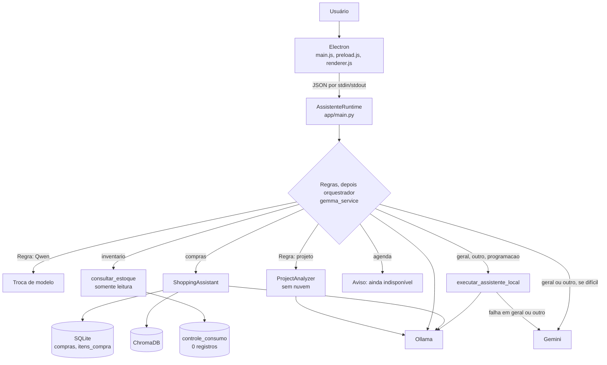

# 08 - Estado Atual da V4

Retrato técnico da **Versão 4 (V4)** do **Assistente Doméstico Inteligente** em **03/11/2026**, na branch `V4`, a partir do commit `c754a6a`, incluindo as correções da seção 6 e a Fase 1. Este documento registra o que funciona de fato, o que existe apenas no código e o que ainda não foi construído.

**Atualizações da V4.1:** seção 11 (17/11/2026), seção 12 (22/11/2026) e seção 13 (23/11/2026, skills). O histórico da versão está em `06 - Evolução da V4 para a V4.1.md`.

> [!IMPORTANT]
> Quando houver conflito entre este documento e descrições mais antigas, vale o que está aqui: ele foi escrito a partir do código e de testes executados. Havendo novas alterações de código, confira novamente.

**Legenda de evidência:** `TESTADO` (executado nesta análise) · `CÓDIGO` (confirmado pela leitura do código) · `DADOS` (confirmado no banco ou nos logs locais) · `NÃO TESTADO` (depende de hardware ou serviço indisponível na análise).

---

## 1. Resumo

A V4 é um assistente doméstico desktop: Electron na interface, Python no back-end, Ollama como IA local e Gemini como contingência na nuvem. A base está organizada e o back-end inicia e encerra corretamente, inclusive sem a chave do Gemini. O **registro de compras** e a **Skill ProjectAnalyzer** são os fluxos mais completos.

A Fase 1 concluiu a base confiável: frases conhecidas são roteadas por regras, compras têm validação e gravação segura, e somente perguntas gerais podem ir à nuvem. A gestão preditiva de estoque **ainda não funciona de ponta a ponta**, pois as compras gravadas não chegam à tabela de estoque (Fase 4).

| Indicador | Valor |
|---|---|
| Código versionado (Python, JS, HTML, CSS) | ≈ 8.070 linhas |
| Testes automatizados | 198 (22 do ProjectAnalyzer, 7 do orquestrador, 45 da Fase 1, 25 da V4.1, 7 do M17, 18 do M11, 13 do M26, 13 das skills, 10 do SK0, SK2, SK3, SKP e SK6, já sem os 5 do orquestrador antigo); ver seções 11 a 13 |
| Testes de estoque, serviços vetoriais reais e IPC | Nenhum |
| Dados reais em `assistente_casa.db` (schema v2) | 4 compras, 11 itens, **0 em `controle_consumo`** |
| Problemas abertos | 10 (1 alto, 5 médios, 4 baixos); 12 resolvidos (P21 em 17/11, P13 e P22 em 22/11, P10 em 23/11) |

---

## 2. Situação das funcionalidades

### Implementado e operante

| Funcionalidade | Observação | Evidência |
|---|---|---|
| Back-end com inicialização Text-First | Chega a `READY` e encerra com código 0 | `TESTADO` |
| Interface Electron com chat, modo voz, mudo e terminal de debug | Contrato IPC revisado; janela não aberta nesta análise | `CÓDIGO` |
| Registro de compras por LLM local, com gravação no SQLite e vetorização | Extração testada com o Gemma real; preço por embalagem e datas conferidos | `TESTADO` |
| Confirmação de compras em caso de dúvida e comando "desfazer última compra" | Desfazer vale para o último registro da sessão | `TESTADO` |
| Roteamento por regras, com o orquestrador apenas para casos ambíguos | 9 de 10 frases medidas foram roteadas sem IA, em menos de 0,1 s | `TESTADO` |
| Política da nuvem | Só `geral` e `outro` vão ao Gemini, fora do Modo Qwen e sem histórico ou memórias restritos | `TESTADO` |
| Skill ProjectAnalyzer sem LLM | Analisou este projeto em 0,2 s | `TESTADO` |
| Memória semântica no ChromaDB e contexto RAG no assistente genérico e no Gemini | Funciona, com filtro permissivo (P19) | `CÓDIGO` + `DADOS` |
| Modo Qwen por comando de texto ou voz | Ativação, desativação e retorno por inatividade testados com troca de modelo simulada | `TESTADO` |

### Parcial

| Funcionalidade | O que falta | Problemas |
|---|---|---|
| Consulta de estoque por texto | A lógica existe, mas a tabela consultada nunca é preenchida | P1 |
| Consultas de gastos e preços | São reconhecidas, mas respondem que a função ainda não existe (Fase 3) | — |
| Modo Qwen como assistente de programação | Não libera a VRAM por completo, não usa de forma garantida o prompt de programação e não executa ferramentas | P7, P10 |
| Agenda | Reconhece o pedido e informa que a função ainda não existe; nada é gravado | P9 |
| Modo voz | Código presente; depende de microfone, Google Speech e Edge TTS | `NÃO TESTADO` |

### Existe no código, mas não está ligado ao fluxo

| Funcionalidade | Situação |
|---|---|
| Ajuste de estoque em nova compra (`processar_estoque_nova_compra`) | Nenhuma chamada no projeto |
| Baixa voluntária (`registrar_fim_estoque_direto`) | Nenhuma chamada no projeto |
| Perguntas de validação por voz | Inalcançáveis na prática (P8) |
| Busca híbrida SQLite + ChromaDB (`busca_hibrida_compra`) | Usada apenas em `scripts/validate_vector_database.py` (P12) |
| `CloudLLMProvider` | Criado em `app/main.py:162`, mas nunca entregue a um assistente |
| Tabela `historico_conversas` | Criada, nunca escrita nem lida |

### Planejado (`OBJETIVO DA VERSÃO.txt`), sem implementação

- Envio de arquivos de texto pelo chat. A interface tem apenas um campo de mensagem.
- Botão ou função "QWEN" no Electron.
- Troca de IA por intenção ("vou programar"). Hoje só frases exatas funcionam.
- Leitura de tela e pesquisa no Google (objetivo futuro).

---

## 3. Arquitetura em uso



| Modelo | Papel | Situação local |
|---|---|---|
| `gemma4:e4b` | Orquestrador e assistente padrão | Baixado; Ollama desligado na análise |
| `qwen2.5-coder:7b` | Modo Qwen e ProjectAnalyzer | Baixado; não executado na análise |
| `gemini-2.5-flash` | Perguntas gerais difíceis e contingência delas | Chamada real não executada |
| `paraphrase-multilingual-MiniLM-L12-v2` | Embeddings na CPU | Em cache; carregou com sucesso |

**Dados que saem da máquina:** perguntas gerais enviadas ao Gemini, com histórico e memórias apenas de `geral` e `outro`; e, no modo voz, áudio enviado ao Google Speech e texto enviado ao Edge TTS. Compras, estoque, agenda, programação e documentação não vão ao Gemini. Com o Ollama parado, frases sem regra também não vão, pois não há como saber se são privadas.

---

## 4. Ambiente e execução

| Item | Verificado em 03/11/2026 |
|---|---|
| Python / Node / Electron | 3.13.5 / 22.15.0 / 31.7.7 |
| Dependências Python principais | Instaladas |
| `GEMINI_API_KEY` | Definida no ambiente do sistema; **não existe `.env`** no projeto. A chave é opcional |
| Cópia do banco antes da Fase 1 | `core/database/backups/assistente_casa_pre_fase1_2026-11-03.db` |
| Ollama | Instalado, serviço parado |

```bash
ollama serve
```

```bash
npm start
```

Executar somente o back-end, sem interface:

```bash
python app/main.py
```

Executar os testes:

```bash
python -m unittest discover -s tests -v
```

**Git:** a branch `V4` está publicada no GitHub e é a branch padrão do repositório desde 16/11/2026. O `V3` remoto contém o commit `a8ad2ca`, que não faz parte da V4.

---

## 5. Validação executada

Os testes usam bancos temporários e LLM simulado. No banco real, foram feitas apenas a migração para o schema v2 e a remoção autorizada da compra nº 5, depois de uma cópia de segurança.

| Verificação | Resultado |
|---|---|
| `python -m unittest discover -s tests` | 70 de 70 aprovados |
| Início do back-end **sem** `GEMINI_API_KEY`, com pedidos de agenda e gastos | `system_ready`, respostas corretas e saída com código 0 |
| Teste real com Gemma (10 frases) | 9 por regras em menos de 0,1 s; "Vou programar agora" ficou local, em 22 s |
| Teste real de extração (4 compras) | Arroz gravaria R$ 27,90 (5 kg na embalagem); "ontem" resultou em 02/11/2026; mercado ausente gerou confirmação |
| `tests/test_gemma_service.py` antes das correções | Falhou nos casos de P2, P6 e P17, confirmando os defeitos |
| Compilação de `app`, `core`, `services` e `scripts` com `SyntaxWarning` como erro | Sem ocorrências |
| ProjectAnalyzer com Qwen real em `services/vector` | 7 chamadas em 81,5 s, cerca de 12 s por chamada |
| ProjectAnalyzer `--sem-llm` neste repositório | 70 arquivos, 5 achados, sem alterações no repositório |
| Reprodução de P1, P2, P4, P5, P6, P11 e P20 | Confirmados antes das correções (seção 6) |

**Não testado:** janela do Electron, chamada real ao Gemini, microfone, TTS e reconhecimento de voz. Amostras reais pequenas não garantem acerto em toda frase ou compra.

O achado de gravidade alta do ProjectAnalyzer é um **falso positivo**: trata-se do token fictício `TOKEN_FALSO`, usado no teste de ocultação de segredos.

---

## 6. Problemas conhecidos

### Gravidade alta

| ID | Problema | Local | Efeito | Evidência |
|---|---|---|---|---|
| P1 | **Compras não alimentam o estoque.** Não existe `INSERT` em `controle_consumo`, e o `ShoppingAssistant` não chama o `InventoryAssistant`. | `services/shopping_assistant.py:245` | Consulta sempre vazia; varredura sem itens; gestão preditiva inoperante | `TESTADO` + `DADOS` |

### Gravidade média

| ID | Problema | Local | Efeito | Evidência |
|---|---|---|---|---|
| P7 | Assistentes usam Gemma fixo mesmo no modo Qwen. | `app/main.py:170` | Os dois modelos podem ocupar a VRAM ao mesmo tempo | `CÓDIGO` |
| P8 | A varredura roda só no início, com o modo voz ainda desligado, e `validacao_pendente` nunca vira pergunta. | `app/main.py:691`, `services/inventory_assistant.py:307` | Validação por voz inalcançável | `CÓDIGO` |
| P9 | Agenda não persiste dados. | `app/main.py` (rota `agenda`) | Nenhum compromisso salvo; o usuário recebe esse aviso | `CÓDIGO` |
| P12 | Vetores de compras em tempo real não têm `entity_id`, e a busca híbrida não está ligada ao fluxo. | `services/shopping_assistant.py:500` | Sem hidratação de valores exatos do SQLite | `CÓDIGO` |
| P14 | Migração e fluxo em tempo real usam IDs diferentes para o mesmo item. | `scripts/migrate_vector_database.py:58`, `services/shopping_assistant.py:491` | Itens duplicados no ChromaDB | `CÓDIGO` |

### Gravidade baixa

| ID | Problema | Local | Evidência |
|---|---|---|---|
| P16 | Sem tratamento do evento `error` do processo Python; falha ao iniciar `python` não é informada na interface. | `main.js:48` | `CÓDIGO` |
| P18 | Erros aparecem apenas no terminal interno, não no chat. | `renderer.js:282` | `CÓDIGO` |
| P19 | Toda frase com 4 ou mais palavras vira memória de longo prazo. | `services/vector/memory_service.py:48` | `CÓDIGO` |
| P20 | Heurística confunde respostas: "sim, mas sobraram dois" e "assim que abri acabou" viram `CONFIRMACAO`. Efeito futuro, pois o fluxo está inativo. | `services/inventory_assistant.py:175` | `TESTADO` |
| P21 | Chat só ficava disponível depois da carga do modelo de embeddings (15 a 50 s nos logs). **Resolvido em 17/11/2026:** chat pronto em 3,5 s e memória em 13,0 s, em segundo plano (seção 11). | `services/vector/embedding_service.py`, `app/main.py` | `MEDIDO` |

### Resolvidos em 23/11/2026

| ID | Problema | Correção | Validação |
|---|---|---|---|
| P10 | `programacao` (e `projetos`) não estavam entre as opções do orquestrador | O orquestrador escolhe entre todas as skills do catálogo (SK2) | `tests/test_sk2.py` (`TESTADO`) |

### Resolvidos em 22/11/2026

| ID | Problema | Correção | Validação |
|---|---|---|---|
| P13 | `rebuild_embeddings.py` apagava a coleção inteira e só recriava dados vindos do SQLite: perda definitiva das memórias `mem_*` | Cópia de segurança, exportação das memórias para JSON, reindexação e regravação das memórias; nada é apagado se a leitura falhar | `tests/test_m11.py` (`TESTADO`) |
| P22 | `with get_connection()` confirmava, mas não fechava a conexão SQLite (`ResourceWarning` nos testes) | Conexão criada com `_ConexaoQueFecha`, que fecha ao sair do `with`, inclusive com erro | `tests/test_m11.py`; suíte sem `ResourceWarning` do SQLite (`TESTADO`) |

### Resolvidos em 03/11/2026

| ID | Problema | Correção | Validação |
|---|---|---|---|
| P2 | `desativar qwen` ativava o Qwen, pois o texto contém "ativar qwen" | Comandos de desativação são avaliados primeiro; `desativar modo qwen` foi incluído | `tests/test_gemma_service.py` |
| P6 | Inatividade de 30 minutos nunca desativava o Qwen, pois o horário era renovado antes da verificação | A verificação ocorre antes da renovação do horário | `tests/test_gemma_service.py` |
| P17 | Sequências de escape inválidas em `PROMPT_PROGRAMACAO`, incluindo `\a`, que virava caractere de controle | O prompt passou a ser string raw | `tests/test_gemma_service.py` |
| P3 | Gemini usava prompt fixo de compras, e falhas locais de compras podiam parecer registradas | Prompt geral; compras não vão à nuvem e a falha é informada | `tests/test_fase1.py` |
| P4 | Consultas de compras eram tratadas como registro | A rota respeita `acao`; consulta nunca grava | `tests/test_fase1.py` |
| P5 | Nova tentativa duplicava compras | Só a extração é repetida; a gravação ocorre uma vez, em transação única | `tests/test_fase1.py` |
| P11 | Sem chave do Gemini, o sistema não iniciava | Cliente criado no primeiro uso; sem chave, tudo fica local | `tests/test_fase1.py` e início real |
| P15 | Erros de cota não eram convertidos | A rota usa `chamar_llm` e não repete em cota esgotada | `tests/test_fase1.py` |

A verificação de inatividade ocorre na solicitação seguinte, não em segundo plano. Enquanto isso, o Ollama libera o modelo ocioso pelo próprio `keep_alive`.

---

## 7. Código sem uso e dívida técnica

- **Sem chamadas no projeto:** `parse_json_com_fallback`, `classificar_intencao_usuario`, `enviar_prompt_json`, `salvar_compra_da_ia`, `obter_itens_expirados_para_validacao`, `obter_dados_produto_por_nome`, `atualizar_recompra_e_ritmo`, `zerar_estoque_item`, `zerar_estoque_por_nome`, `pre_carregar_modelo` e os callbacks de áudio e voz.
- **Duplicado:** `_sanitizar_resposta_json` em `gemma_service.py` (sem uso) e nos dois provedores de LLM.
- **Configurações sem uso:** `SAMPLE_RATE`, `CHANNELS`, `CHUNK_SIZE`, `RECORD_SECONDS` e `GEMINI_API_KEY` em `core/config.py`.
- **Dependência sem uso direto:** `requests`.
- **Estado de interface sem origem:** o back-end nunca emite `RESPONDING`.
- **Cobertura:** roteamento, compras, política da nuvem e parte do runtime têm testes. Faltam estoque, serviços vetoriais reais, voz e IPC.

---

## 8. Objetivo da versão × entrega

| Item do `OBJETIVO DA VERSÃO.txt` | Situação |
|---|---|
| Electron com chat de texto | Entregue |
| Ligar e desligar microfone | Entregue (não testado com hardware) |
| Enviar arquivos de texto pelo chat | Não entregue |
| Segunda IA local (Qwen 2.5-Coder 7B) | Parcial |
| Trocar de IA por comando de texto ou voz | Entregue para frases exatas |
| Trocar de IA por função no Electron | Não entregue |
| Voltar ao Gemma ao pedir | Entregue para frases exatas |
| Voltar ao Gemma ao reiniciar | Entregue (estado apenas em memória) |
| Voltar ao Gemma após 30 min sem atividade | Entregue, com aplicação na solicitação seguinte |

---

## 9. Documentação do projeto

| Documento | Situação em 03/11/2026 |
|---|---|
| `01` a `05` nesta pasta | Atualizados para a V4 nesta revisão |
| `06 - Evolução da V3 para a V4.md` | Criado nesta revisão |
| `07 - Skill ProjectAnalyzer.md` | Correto |
| `README.md` | Reescrito para a V4 em 16/11/2026; selo de testes e contagem atualizados em 17/11/2026 |
| `CHANGELOG.md` | Atualizado com as correções de 03/11/2026; a lista completa de problemas está neste documento |

---

## 10. Próximos passos recomendados

Ordem aprovada em 03/11/2026:

1. **Fase 1, base confiável:** concluída.
2. **Fase 2, documentação:** pedidos naturais, leitura de `.md` e `.txt` e mais contexto para os modelos.
3. **Fase 3, consultas de compras:** gastos por mês, mercado e categoria, além de histórico de preços.
4. **Fase 4, estoque (P1):** catálogo de produtos, itens recorrentes, conversão de unidades e ritmo de consumo.
5. **Fase 5, lista e previsões:** lista de compras e comparação entre mercados.

Pendências paralelas: concluir o modo Qwen (P7, P10, botão e troca por intenção), definir o envio de arquivos pelo chat e a agenda, publicar a branch `V4` e atualizar `README.md`.

---

## 11. Atualização V4.1 (17/11/2026)

Alterações feitas depois do retrato de 03/11/2026. As seções anteriores não foram reescritas; onde houver conflito, vale esta.

| Item | O que mudou | Evidência |
|---|---|---|
| Integração contínua | Fluxo `Testes` no GitHub Actions: sintaxe Python e JavaScript, suíte completa e linter informativo | `CÓDIGO`; execução no GitHub `NÃO TESTADO` |
| Saída estruturada | Orquestrador e extração de compras enviam JSON Schema no `format` do Ollama; recaída para `format="json"` com biblioteca antiga; opção `OLLAMA_SAIDA_ESTRUTURADA` | `MEDIDO`: 100% de respostas válidas, acerto igual ao JSON simples |
| Início do sistema (P21) | Modelo de embeddings carregado em segundo plano; busca semântica ignorada durante a carga; memória gravada depois da resposta | `MEDIDO`: chat em 3,5 s, memória em 13,0 s |
| Leitura dos comandos do Electron | Pipe lido por descritor privado (`ENTRADA_IPC`); entrada padrão trocada por `os.devnull`. Sem isso, a carga dos embeddings travava até a mensagem seguinte | `MEDIDO`: antes não ficava pronta em 150 s |
| Embeddings | `EMBEDDING_DEVICE` (padrão `cpu`; antes ia para `cuda:0`) e carga só do cache local, sem as ≈ 30 consultas ao Hugging Face por início | `MEDIDO` |
| Orquestrador | Raciocínio (`think`) desligado no Gemma 4; opção `OLLAMA_RACIOCINIO` no `.env` | `MEDIDO`: 8,1 s → 1,2 s por decisão, 16/16 acertos |
| Ollama fechado (M17) | Verificação de saúde de 2 s antes de chamar o modelo; erro de conexão sem repetição; mensagem com botão "Tentar de novo"; aviso no início | `MEDIDO`: resposta em 2,38 s com o Ollama fechado (antes, no mínimo 6 s) |
| Banco vetorial | `upsert_documents` cancela a gravação quando não há embeddings | `TESTADO` |

**Validação:** `python -m unittest discover -s tests` com 105 de 105 aprovados em Python 3.10, com `ollama`, `python-dotenv` e `google-genai` substituídos por módulos simulados (os testes não chamam esses serviços). Compilação de `app`, `core`, `services`, `scripts` e `tests` com `SyntaxWarning` como erro, sem ocorrências. `node --check` nos três arquivos do Electron, sem erros.

**Comportamento a observar no uso real:**
- Uma compra registrada nos primeiros segundos após abrir o aplicativo aguarda o fim da carga dos embeddings antes de confirmar, pois a vetorização ocorre antes da resposta.
- A primeira extração de compras com esquema deve ser conferida com frases reais (as quatro do teste da seção 5). Se a qualidade cair, `OLLAMA_SAIDA_ESTRUTURADA=0` restaura o comportamento anterior.
- O esquema exige servidor Ollama e biblioteca `ollama` compatíveis com saída estruturada (`pip install -U ollama`).

### Medições no PC do usuário (17/11/2026)

Feitas com `scripts/medir_v41.py`; relatórios completos em `Planejamento/medicoes`.

| Orquestrador (16 chamadas, modo esquema) | Acertos | Mediana | Tokens gerados |
|---|---|---|---|
| Gemma 4 E4B com raciocínio (anterior) | 16/16 | 8,1 s | 448 |
| **Gemma 4 E4B sem raciocínio (adotado)** | **16/16** | **1,2 s** | 36 |
| Qwen 2.5 Coder 7B | 16/16 | 1,5 s | 42 |

- O Gemma 4 E4B continua como orquestrador: acerta o mesmo que o Qwen, responde mais rápido e ocupa menos VRAM.
- O gargalo era o raciocínio ligado por padrão no Ollama, não a capacidade do modelo: de 1.200 a 2.700 caracteres de raciocínio por decisão.
- A extração de compras ainda roda com o raciocínio no padrão (6/6 acertos, mediana de 10,8 s com esquema). Desligar depende de nova medição.
- Amostra pequena: 8 frases com 2 repetições cada. Um conjunto de avaliação maior (M13) segue recomendado.

## 12. Atualização V4.1 (22/11/2026)

| Item | O que mudou | Evidência |
|---|---|---|
| Cópia de segurança (M11) | Uma cópia por dia ao abrir o app (e a cada hora, se continuar aberto) em `core/database/backups/auto/AAAA-MM-DD/`: banco por `VACUUM INTO` com `integrity_check`, ChromaDB em `chroma_db.zip`, `manifesto.json` com SHA-256. Retenção de 7 diárias e 4 semanais. `scripts/fazer_backup.py` para cópia manual | `TESTADO` (18 testes); cópia dos dados reais em pasta temporária: 12 ms, contagens iguais à origem |
| Registro de eventos (M26) | `Logs/eventos-AAAA-MM-DD.jsonl`, uma linha JSON por evento, identificador por requisição e tempo por etapa; retenção de 30 dias; `LOG_CONTEUDO=0` omite o texto do usuário; `scripts/ver_logs.py` para leitura e resumo por etapa | `TESTADO` (13 testes e 1 de integração com o pipeline) |
| Reconstrução dos embeddings (P13) | Preserva as memórias `mem_*` | `TESTADO` |
| Conexões SQLite (P22) | Fechadas ao sair do `with` | `TESTADO` |

**Validação:** `python -m unittest discover -s tests` com 137 de 137 aprovados em Python 3.10, com `ollama`, `python-dotenv` e `google-genai` simulados. Compilação com `SyntaxWarning` como erro e `node --check` sem ocorrências.

**Restaurar uma cópia:** com o app fechado, copie `assistente_casa.db` da pasta do dia para `core/database/` e extraia `chroma_db.zip` em `core/database/chroma_db/` (pasta vazia). O `manifesto.json` traz o SHA-256 de cada arquivo para conferência.

**Observações:**
- Os arquivos `Logs/<módulo>/log.txt` deixaram de receber linhas; ficam como histórico até serem apagados manualmente.
- Alguns testes antigos (`test_gemma_service.py` e parte de `test_fase1.py`) não redirecionam os logs e escrevem no `Logs/` real ao rodar a suíte. Já acontecia com os arquivos `.txt`.
- O único `ResourceWarning` restante na suíte vem de `_isolar_entrada_ipc` (`app/main.py`), que deixa o `os.devnull` aberto de propósito durante toda a execução.

## 13. Skills: SK0 e SK1 (23/11/2026)

| Item | O que mudou | Evidência |
|---|---|---|
| Formato de skill (SK1) | `skills/<nome>/SKILL.md` com cabeçalho YAML e `prompts/*.md`; catálogo em `core/skills/` | `TESTADO` (13 testes) |
| Roteador por regras | Gatilhos lidos dos cabeçalhos das skills, em ordem de prioridade | `TESTADO`: 0 diferenças em 168 decisões de referência |
| Prompts | Programação, extração de compras e assistente geral fora do Python | `TESTADO`: mesmo texto |
| Medição (SK0) | `scripts/avaliar.py` com `evals/casos.jsonl` (48 frases) e `evals/compras.jsonl` (8 compras) | Ferramenta `TESTADO`; medição real `NÃO TESTADO` (requer o Ollama no PC) |

| Medição (SK0, PC do usuário) | Gemma no catálogo: 45/48 em 0,55 s; prompt por contextos: 43/48 em 1,39 s; Qwen Coder falha na chamada nativa; troca de modelo 13 a 15 s | `MEDIDO` (`Planejamento/medicoes/sk0-20261123-0825.md`) |
| Orquestrador (SK2) | Escolhe a skill pelo catálogo, com prompt fixo; resolve o P10 (o prompt por contextos foi removido no SK5) | `TESTADO` (10 testes) e `MEDIDO` no PC: 44/48 em 0,87 s (antes 43/48 em 1,39 s) |
| Privacidade | Pesquisa de preço entre mercados passa por gatilho de `compras` (antes podia cair na conversa geral) | `TESTADO` |

| Roteiros (SK3) | Compras, estoque e agenda executam `skills/<nome>/roteiro.py`; confirmação de compra virou pendência genérica de qualquer skill | `TESTADO` (7 testes) |

| Programação (SKP) | Claude (API) como principal; sem cota, Qwen local; reteste na primeira solicitação depois das 8h; limite mensal de gasto; biblioteca de contexto no ChromaDB | `TESTADO` (18 testes); chamada real `NÃO TESTADO` |

| Limpeza (SK5) | Orquestrador antigo removido; documentação de projeto com roteiro; contextos válidos vindos do catálogo; `main.py` dividido em `ipc`, `sessao` e `voz` | `TESTADO` (191 testes) e teste de fumaça do processo real |

| Fábrica de skills (SK6) | `scripts/nova_skill.py` a partir de `skills/_modelo`; `scripts/validar_skills.py` na integração contínua; `llm_local` para toda skill | `TESTADO` (7 testes) |

**O que ainda não muda:** a conversa geral continua no `app/main.py`, porque a política de nuvem (Gemini) é do núcleo.

**Validação:** 198 de 198 testes aprovados, nas mesmas condições da seção 12.
