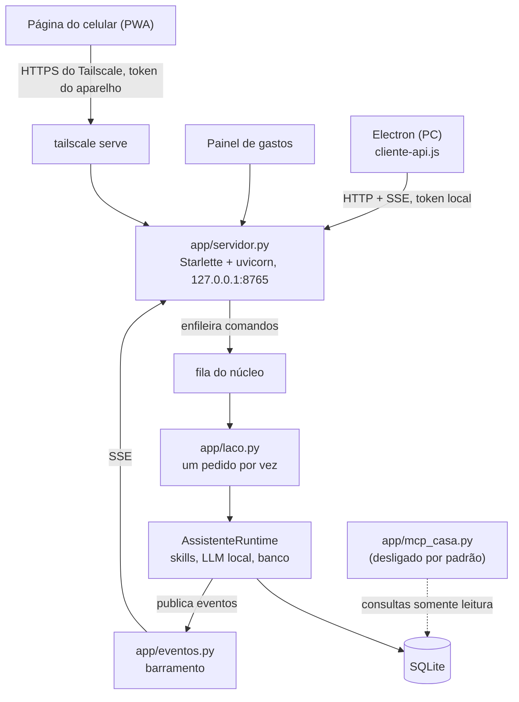

# 09 — Servidor, celular e painel (V5.5)

Na V5.5 o núcleo do assistente deixou de depender da janela do Electron: virou um **serviço de rede**. O Electron, a página do celular e o painel de gastos são clientes do mesmo núcleo e veem a mesma conversa.

## Arquitetura



| Peça | Arquivo | Papel |
|---|---|---|
| Barramento de eventos | `app/eventos.py` | O núcleo publica cada evento uma vez; cada cliente recebe; os últimos 60 eventos de conversa ficam para quem conecta depois |
| Laço de comandos | `app/laco.py` | Consome a fila (texto, voz, documento, voz/mudo) — vale para a ponte antiga e para a API |
| Notas fiscais | `app/documentos_app.py` | Importação de nota vinda da pasta, do PC, do celular ou do Telegram |
| API | `app/servidor.py` | Rotas abaixo; só enfileira, não executa nada por conta própria |
| Tokens | `services/dispositivos_service.py` | Um token por aparelho, só o hash gravado, revogável; escopo `local` (PC) ou `remoto` (celular) |
| Electron | `cliente-api.js` | Inicia o servidor se ele não estiver no ar, lê os eventos por SSE e manda comandos por POST |

### Rotas

| Rota | O quê | Quem |
|---|---|---|
| `GET /api/saude` | Estado do núcleo | qualquer um (sem dados) |
| `POST /api/mensagens` | Envia texto | com token |
| `POST /api/comandos` | Voz, mudo, arquivo pelo caminho, desligar | só o PC (`local`) |
| `POST /api/anexos` | Foto, PDF ou HTML da nota (até 20 MB, 5 por vez) | com token |
| `GET /api/eventos` | Fluxo de eventos (SSE): histórico recente e depois tudo o que acontece | com token |
| `GET /api/gastos/resumo` | Números do painel | com token |
| `GET /entrar?token=…` | Grava o token num cookie (HttpOnly, SameSite=Strict) e abre a página | link gerado no PC |

Segurança: o servidor escuta só em `127.0.0.1`; nenhuma porta é aberta para a internet. Toda resposta leva `Content-Security-Policy`, `X-Frame-Options` e `nosniff`. O celular não alcança arquivos do PC (comando `documento` só no escopo `local`).

## Como usar

### No PC
Nada muda: `iniciar-assistente.bat`. O Electron sobe o servidor sozinho e se conecta. Para voltar à ponte antiga (stdin), defina `ASSISTENTE_PONTE=stdin`.

Para deixar o assistente disponível **sem a janela** (só celular e painel): `iniciar-servidor.bat`. Se o Electron abrir depois, ele se conecta ao servidor que já está rodando e não o desliga ao fechar.

### No celular (fora de casa), pelo Tailscale
1. Instale o **Tailscale** no PC e no celular e entre com a **mesma conta** (https://tailscale.com/download).
2. No PC, uma vez só, num terminal: `tailscale serve --bg 8765` — o Tailscale passa a entregar o assistente em `https://<nome-do-pc>.<sua-rede>.ts.net`, com certificado HTTPS, só para os seus aparelhos.
3. No PC: `novo-dispositivo.bat`, dê um nome ("Celular do Felipe"). Ele mostra um link `https://…/entrar?token=…`.
4. Abra esse link **no celular** (uma vez). No Chrome do Android: menu ⋮ → **Instalar app** (ou "Adicionar à tela inicial").
5. Pronto: conversa, foto da nota (📷 abre a câmera) e painel de gastos (📊).

Perdeu o celular? `python scripts/dispositivos.py revogar "Celular do Felipe"`. Ver os aparelhos: `python scripts/dispositivos.py listar`.

Sem Tailscale, só na rede de casa: `API_HOST=0.0.0.0` no `.env` e o link `http://<IP-do-PC>:8765/entrar?token=…` (sem HTTPS, a página não instala, mas funciona no navegador).

### Painel de gastos
Botão **📊 Gastos** na janela do PC, ou 📊 na página do celular. Total, média mensal, gastos por mês, categoria e loja e as últimas compras, com 3, 6, 12 ou 24 meses.

### Modo demonstração
`iniciar-demo.bat`: banco, memória, anexos e ideias separados (`core/database/demo/`), ~140 compras fictícias em lojas inventadas, porta 8766, bot do Telegram desligado. Serve para gravar vídeos sem mostrar dados reais. Recriar os dados: `set ASSISTENTE_DEMO=1 && python scripts/criar_demo.py --recriar`.

### Servidor MCP (opcional, desligado)
`app/mcp_casa.py` expõe 6 consultas somente leitura (total, lista, por categoria, por loja, preço de produto, comparação de períodos) para o Claude usar. **Ligar é uma exceção à regra de que compras não saem do PC**: o que as consultas respondem vai para a Anthropic. Para ligar no Claude Code:

```
claude mcp add assistente-casa -- python "E:\Agente IA\assistente-domestico\app\mcp_casa.py"
```

## O que ficou de fora

| Item | Motivo |
|---|---|
| Áudio pela página do celular | Exige transcrição; a transcrição local entra na V6.5 (M29). Hoje o modo voz do PC usa o Google Speech |
| Atualizar o Electron (M28) | Precisa de `npm install` e teste no PC; o projeto segue no Electron 31 |
| Fila de envio sem conexão no celular | Fica para o app nativo (V6) |
| WebSocket | Trocado por SSE (eventos do servidor): o fluxo é só do servidor para os clientes, funciona no navegador sem biblioteca e passa pelo proxy do Tailscale; os comandos vão por POST |
